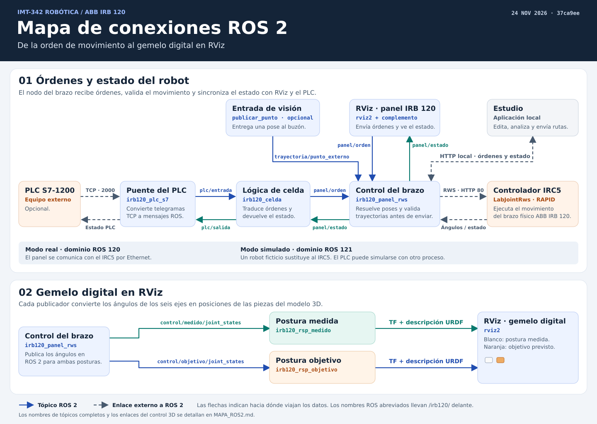

# Mapa de conexiones ROS 2 · ABB IRB 120



El nodo **`irb120_panel_rws`** conecta las interfaces de la PC con el controlador ABB IRC5. Recibe órdenes, valida la trayectoria y lee la postura del robot. RViz muestra dos modelos superpuestos: **blanco** para la postura medida y **naranja** para el objetivo. Estudio edita y analiza trayectorias, y el PLC puede seleccionar y coordinar una trayectoria desde su propia interfaz.

Diagrama de arquitectura de la revisión `37ca9ee` (24/11/2026). Los caminos físicos, simulados y de diagnóstico se activan desde distintos comandos.

## Tópicos de control y estado

Una flecha va del nodo que **publica** al nodo que **escucha**. Las órdenes y los estados de la tabla viajan como JSON dentro de `std_msgs/msg/String`.

| Publica | Tópico | Escucha | Qué viaja |
|---|---|---|---|
| `irb120_plc_s7` | `/irb120/plc/entrada` | `irb120_celda` | Telegrama del PLC ya interpretado, con la orden y sus datos. |
| `irb120_celda` | `/irb120/plc/salida` | `irb120_plc_s7` | Estado de ejecución y señales para responder al PLC. |
| Panel IRB 120 dentro de `rviz2`, o `irb120_celda` | `/irb120/panel/orden` | `irb120_panel_rws` | Órdenes del usuario o de la celda. |
| `irb120_panel_rws` | `/irb120/panel/estado` | Panel IRB 120 dentro de `rviz2` e `irb120_celda` | Postura, objetivo y progreso de la trayectoria. |
| `publicar_punto` u otra fuente de poses compatible | `/irb120/trayectoria/punto_externo` | `irb120_panel_rws` | Excepción al formato JSON: `geometry_msgs/msg/PoseStamped` del TCP en `base_link`, con posición en metros y orientación como cuaternión. |

`publicar_punto` es un nodo temporal. El panel añade la pose al buzón si es alcanzable. La integración disponible es la entrada de poses para una fuente externa de visión.

## Cómo se actualiza RViz

| Publica | Tópico o servicio | Escucha o usa | Qué hace |
|---|---|---|---|
| `irb120_panel_rws` | `/irb120/control/medido/joint_states` | `irb120_rsp_medido` | Ángulos medidos de los seis ejes, en radianes. |
| `irb120_panel_rws` | `/irb120/control/objetivo/joint_states` | `irb120_rsp_objetivo` | Ángulos del objetivo de vista previa, en radianes. |
| Ambos `irb120_rsp_*` | `/irb120/control/tf` y `/irb120/control/tf_static` | RViz (escucha TF) | Transformaciones para colocar cada pieza del modelo. El panel también publica en `tf_static` para anclar los dos modelos a `base_link`. |
| Cada `irb120_rsp_*` | `/irb120/control/medido/robot_description` o `/irb120/control/objetivo/robot_description` | RViz | Descripción URDF del modelo correspondiente. |
| `irb120_panel_rws` | `/irb120/control/texto` | RViz | Texto de estado en la vista 3D. |
| `irb120_panel_rws` | `/irb120/control/articulacion/update` | RViz | Actualiza el marcador de pose que se puede arrastrar. |
| RViz | `/irb120/control/articulacion/feedback` | `irb120_panel_rws` | Envía ajustes de la pose y selecciones del menú 3D. |
| `irb120_panel_rws` (servidor) | `/irb120/control/articulacion/get_interactive_markers` | RViz (cliente) | Servicio para obtener los marcadores iniciales. |

El panel IRB 120, el control 3D y el gemelo se muestran en la misma aplicación RViz. Las publicaciones articulares son `sensor_msgs/msg/JointState`. TF transporta relaciones de posición y orientación entre sistemas de coordenadas.

## Enlaces con equipos y aplicaciones externas

| Extremos | Protocolo | Datos |
|---|---|---|
| PLC S7-1200 ↔ `irb120_plc_s7` | Telegramas binarios por TCP, puerto 2000 por defecto | Órdenes hacia la PC y estado de vuelta al PLC. |
| Estudio ↔ `irb120_panel_rws` | HTTP local, puerto 8770 en modo real y 8771 en simulado por defecto | Peticiones para preparar o enviar trayectorias y consultar el estado. La página web opcional usa el mismo servidor. |
| `irb120_panel_rws` ↔ IRC5 | RWS sobre HTTP por Ethernet, puerto 80 por defecto | El panel escribe órdenes para `LabJointRws` y lee postura y estado. El programa RAPID en el IRC5 ejecuta el movimiento. |

## Simulación y diagnóstico

| Modo | Nodos y conexiones |
|---|---|
| `brazo.sh panel` / `brazo.sh sesion` | Control principal con el IRC5, dominio ROS 120. `sesion` también abre Estudio. El puente y la lógica PLC se añaden con `brazo.sh plc`. |
| `brazo.sh simulado` / `brazo.sh demo` | Dominio ROS 121. `irb120_panel_rws` usa un robot ficticio en el mismo proceso. `demo` también arranca Estudio y los dos nodos de celda PLC. El simulador del PLC se inicia como proceso aparte. |
| Hito 1 · simulación del modelo | `irb120_slider_gui` o `irb120_motion_demo` → `/irb120/joint_commands_deg` → `irb120_joint_state_source` → `/joint_states` → `irb120_robot_state_publisher` → `/tf`, `/tf_static` y `/robot_description` → RViz. `irb120_fk_validator` observa los ángulos y TF y publica errores de posición que consume el panel de controles. |
| Hito 2 · IK y trayectoria ROS | El lanzamiento reutiliza el gemelo del Hito 1 con el panel de controles desactivado. `irb120_ik_trajectory` escucha `/irb120/target_pose` y `/joint_states`, y publica `/irb120/joint_commands_deg`, `/irb120/planned_trajectory` e `/irb120/ik_status`. |
| Hito 3 · observación del IRC5 | IRC5 → RWS → `abb_rws_joint_bridge` → `/irb120/real/joint_states` → `robot_state_publisher` → RViz. `irb120_monitor_comunicacion` observa ángulos, telemetría `/irb120/real/joint_states/rws` y `/irb120/real/tf`. Con la validación FK activada, `irb120_validacion_fk` escucha `/irb120/real/joint_states/fk_sample` y publica `/irb120/real/joint_states/fk_sample/resultado`. |
| Ensayo articular / EGM | El lanzador `iniciar.sh` ofrece un flujo de ensayo con `irb120_ensayo_articular` que reutiliza los dos publicadores de postura. El control principal del mapa utiliza RWS. |

Para comparar el mapa con lo que está ejecutándose, el repositorio ya trae un comando que descubre los nodos y sus tópicos. Con una sesión **simulada** abierta, ejecutar desde `ros2_ws` en otra terminal:

```bash
./brazo.sh nodos --simulado --png ../salidas/grafo_ros.png
```

El PNG en vivo incluye los tópicos descubiertos por ROS 2 en ese dominio. La salida de terminal muestra quién publica y quién escucha. Los enlaces HTTP, TCP y RWS se consultan en este mapa. Los modos de simulación y diagnóstico se documentan en los lanzadores del [Hito 1](../ros2_ws/src/irb120_hito1/launch/display.launch.py), [Hito 2](../ros2_ws/src/irb120_hito2/launch/hito2.launch.py) y [conexión de lectura RWS](../ros2_ws/src/irb120_conexion/irb120_conexion/arranque/comunicacion.py).

## Código de referencia

| Parte del mapa | Archivos |
|---|---|
| Inicio y dominios ROS 2 | [brazo.sh](../ros2_ws/brazo.sh), [iniciar.sh](../ros2_ws/iniciar.sh) |
| Control y publicación de posturas | [puente_ros.py](../ros2_ws/src/irb120_control/irb120_control/panel/puente_ros.py), [vista.py](../ros2_ws/src/irb120_control/irb120_control/panel/vista.py) |
| Panel y controles 3D de RViz | [cliente_ros.cpp](../ros2_ws/src/irb120_rviz_panel/src/cliente_ros.cpp), [rviz_controles.py](../ros2_ws/src/irb120_control/irb120_control/panel/rviz_controles.py) |
| PLC y lógica de celda | [nodo_plc.py](../ros2_ws/src/irb120_control/irb120_control/plc/nodo_plc.py), [nodo_celda.py](../ros2_ws/src/irb120_control/irb120_control/celda/nodo_celda.py), [contrato de telegramas](PLC_S7_1200.md) |
