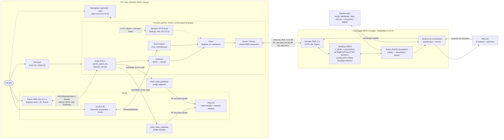

# Cómo funciona: mover el IRB 120 desde la PC

Explicación técnica de la conexión PC ↔ IRC5 que movió el robot real el **16/11/2026**: qué elementos hay, cómo están conectados, qué protocolos usan y cómo viaja un ángulo desde que se escribe hasta que el motor gira y la lectura vuelve.

Rutas relativas a `proyecto/`. `C` = `ros2_ws/src/irb120_control/irb120_control/`, `PN` = `C/panel/` (el panel Python), `CPP` = `ros2_ws/src/irb120_rviz_panel/src/` (el panel C++ de RViz), `MOD` = `ros2_ws/src/irb120_control/rapid/rws_mover/LabJointRws.mod`. Lo marcado **[general]** es conocimiento de RWS 1.0 / RobotWare 6 que no se comprobó por separado en este proyecto.

---

## 1. Resumen

- El 16/11/2026 la PC envió **24 órdenes reales** al IRB 120 (J6, J1, J4, J3 y J2). Las 24 terminaron con código de llegada `2`; el error final por orden fue ≤ 0,016° (registro `salidas/control_articular/rws_mover/interactivo_20261117_012222_264923Z.jsonl`). J5 también se probó, pero dio `HTTP 403` tras detener RAPID; ya está corregido (§9) y falta repetirlo.
- **La PC no mueve motores.** Escribe un objetivo articular en variables RAPID del controlador mediante **RWS** (REST sobre HTTP).
- Un programa RAPID que corre **dentro del controlador** (`ServidorPC`, módulo `LabJointRws`) ve el objetivo nuevo, lo valida y ejecuta `MoveAbsJ` (articular) o `MoveL` (lineal), según `pcTipo`. Desde la v5 cada tramo va en una sola orden, sin paradas intermedias. Planificación, servocontrol y seguridad siguen siendo del IRC5.
- La PC lee la postura real por RWS y la dibuja en RViz junto al objetivo. **Todo el control está dentro de RViz**: un panel «IRB 120» (C++) y un marcador 3D arrastrable. La página web es opcional (`--web`).
- Es un sistema **orden a orden** (una orden cada pocos segundos), no de control en tiempo real.

---

## 2. Mapa de conexiones



Versión en texto:

```
 Usuario
   │ escribe ángulos / pose, pulsa «Enviar»      │ arrastra el marcador / clic derecho
   ▼                                              ▼
 ┌──────────────────────────── RViz2 ─────────────────────────────┐   (opcional --web)
 │ Panel «IRB 120» (C++)     Control 3D        Vista 3D ◄── TF     │   Navegador 127.0.0.1:8770
 └───────┬──────────────────────┬──────────────────▲──────────────┘        │ HTTP (token)
         │ /irb120/panel/orden  │ InteractiveMarker│                       │
         │ ▲ /irb120/panel/estado (String JSON, 4 Hz, solo localhost)      │
         ▼ │                    ▼                  │                       ▼
 ┌──────────────── proceso panel.arranque (Python) ────────────────────────────┐
 │ nodo ROS 2 → Ordenes (JSON → acción) ─┐                                     │   robot_state_publisher ×2
 │ RvizControls (IK arrastrando) ────────┼→ Panel (objetivo, IK Pieper,        │   (medido/, objetivo/)
 │ web.py (opcional) ────────────────────┘   validación) → Mover (cliente RWS) │      ▲
 │                       nodo ROS 2 ─────────────────────────────────────────────► JointState 10 Hz
 └──────────────────────────────────┬──────────────────────────────────────────┘
                                    │ Ethernet (cable al puerto X2 Service)
                                    │ IPv4 192.168.125.203 → 192.168.125.1, TCP 80, HTTP Digest
                                    ▼
 IRC5: servidor RWS → variables PERS de LabJointRws (T_ROB1)
                     → rutina ServidorPC (Validar, MoveAbsJ / MoveL)
                     → planificador y servos → motores del IRB 120
                     ← resolvers ← posición real → jointtarget (se lee por RWS)
 FlexPendant: modo de operación, habilitador, Start, «Iniciar», «Conceder» RMMP
```

| Elemento | Dónde corre | Papel |
|---|---|---|
| Panel «IRB 120» (`PanelIRB120`, `CPP/panel_irb120.cpp`) | RViz (PC), C++ | Interfaz de control: estado, ángulos, pose + IK, envío con confirmación. Solo habla JSON por dos tópicos |
| Control 3D (`PN/rviz_controles.py`) | PC, dentro del proceso Python | Marcador arrastrable con IK en vivo y menú de clic derecho |
| Nodo `irb120_panel_rws` (`PN/puente_ros.py`) | PC | Publica posturas y estado; recibe las órdenes JSON |
| `Ordenes` (`PN/ordenes.py`) | PC | Valida cada orden JSON y la pasa al `Panel`; sin ROS |
| `Panel` (`PN/estado.py`) | PC | Objetivo, lectura del robot, IK, envío en segundo plano, registro |
| `Mover` (`C/rws_mover.py:154`) | PC | Escribe el objetivo, hace el handshake y lee el estado |
| Página local (`PN/web.py`, `PN/web.html`) | PC, **opcional** (`--web`) | Mismo `Panel` desde un navegador |
| `robot_state_publisher` ×2 | PC | Convierte ángulos en transformadas TF para los dos modelos |
| RViz2 | PC | Dibuja el robot medido (sólido) y el objetivo (naranja) y aloja el panel |
| Servidor RWS | IRC5 | API REST de RobotWare para leer y escribir el controlador |
| `LabJointRws` / `ServidorPC` (`MOD`) | IRC5, tarea `T_ROB1` | Recibe objetivos y ejecuta `MoveAbsJ` o `MoveL` |
| FlexPendant | Operador | Modo, motores, arranque, permisos. Siempre manda sobre la PC |

---

## 3. Capas y protocolos

### 3.1 Física, red y transporte

| Capa | Qué se usa | Detalle |
|---|---|---|
| Física | Ethernet por cable | Adaptador USB-Ethernet de la PC (`enx00e04c36006d`) al puerto **X2 Service** del IRC5 |
| Enlace | Ethernet | MAC del controlador `00:30:64:50:7d:f9`; el prefijo `00:30:64` pertenece a ABB |
| Red | IPv4, subred `192.168.125.0/24` | El controlador es `192.168.125.1` y entrega por DHCP la IP de la PC (hoy `.203`). El Wi-Fi de la PC sigue siendo la ruta por defecto, pero la ruta `192.168.125.0/24` es más específica y gana |
| Transporte | TCP, puerto 80 | Sin TLS. Puertos abiertos en el IRC5: 21, 80 y 5515; el 443 está cerrado, lo que confirma RobotWare 6 y no OmniCore |

`build_base_url` (`ros2_ws/src/irb120_conexion/irb120_conexion/nodos/lectura_articular/puente_rws.py:37`) solo acepta una IPv4 concreta y fuerza el puerto 80, salvo en `127.0.0.1` para los simulacros.

### 3.2 Aplicación: RWS 1.0 (Robot Web Services de RobotWare 6.12)

- **Estilo:** REST sobre HTTP/1.1. Cada recurso del controlador es una URL. Se pide JSON con `?json=1`; las respuestas traen `_embedded._state` con filas tipadas (`rap-data`, `rapid-jointtarget`, `pnl-opmode`…).
- **Autenticación:** HTTP **Digest MD5**. Verificado: un GET sin credenciales devuelve `401` con `WWW-Authenticate: Digest realm="validusers@robapi.abb", qop="auth", algorithm="MD5"`. El usuario es `Default User` y la contraseña se pide en la terminal con `getpass`; no se guarda en ningún archivo.
- **Sesión:** `requests.Session` con `trust_env=False`, para que no use proxies del sistema. Tras la autenticación el controlador entrega una cookie de sesión que se reutiliza **[general]**. RW6 admite pocas sesiones simultáneas, por eso al salir se hace `GET /logout` (`C/rws_mover.py:338`).
- **Escrituras:** `POST` con cuerpo `application/x-www-form-urlencoded`, por ejemplo `?action=set` y `value=[[...],[...]]`. El controlador responde `204 No Content` si acepta.
- **Permisos:**
  - **Mastership** (`/rw/mastership/rapid`): exclusividad para *editar* el programa. Solo se pide al instalar el módulo (`C/rws_j6.py:442`).
  - **RMMP** (Remote Mastership/Modify Privilege, `POST /users/rmmp` con `privilege=modify`): en **modo manual**, RobotWare solo deja escribir variables RAPID a un cliente remoto si el operador pulsa **Conceder** en el FlexPendant.
    - Mientras dure la sesión hay que sondear `/users/rmmp/poll` cada 2 s (`C/rws_mover.py:130`) desde una conexión paralela con la misma cookie. Esa conexión se renueva cada 30 s (`:133`); si se deja de sondear, el ABB revoca el permiso.
    - En **AUTO** no hace falta RMMP.

**Endpoints que usa el sistema**

| Método | Ruta | Para qué | Cuándo | Requisito |
|---|---|---|---|---|
| GET | `/rw/system` | Nombre del sistema (`120-101516`) y versión de RobotWare (`6.12.01.00`). El código se niega a seguir si no coinciden (`C/rws_j6.py:314`) | Al conectar | Login |
| GET | `/rw/panel/opmode` | Modo: `MANR`, `MANF` o `AUTO` | Estado, antes de cada orden | Login |
| GET | `/rw/panel/ctrlstate` | Motores: `motoron`, `motoroff` o `guardstop` | Estado, antes de cada orden | Login |
| GET | `/rw/rapid/execution` | RAPID `running` o `stopped` | Estado, durante cada orden | Login |
| GET | `/rw/rapid/tasks/T_ROB1/motion?resource=jointtarget` | **Postura medida**: 6 ejes en grados más 6 ejes externos (`9E+09` = sin eje) | Cada 0,3 s en el panel y cada 0,25 s durante una orden | Login |
| GET | `/rw/rapid/symbol/data/RAPID/T_ROB1/LabJointRws/{pcTarget,pcPose,pcTipo,pcVelPct,pcSeq,pcFin,rbSeq,rbCodigo,rbActivo}` | Leer el protocolo PC ↔ RAPID | Estado, durante cada orden | Login |
| POST | `…/LabJointRws/pcTarget?action=set` · `value=[[q1..q6],[9000000000×6]]` | Escribir el objetivo | Cada orden | Manual: RMMP · Auto: nada |
| POST | `…/LabJointRws/{pcPose,pcTipo,pcVelPct}?action=set` | Escribir pose, tipo y velocidad antes de `pcSeq` | Cada orden | Ídem |
| POST | `…/LabJointRws/pcSeq?action=set` · `value=N` | "Disparo" de la orden N | Cada orden | Ídem |
| POST | `…/LabJointRws/pcFin?action=set` · `value=1` | Terminar `ServidorPC` | `terminar` | Ídem |
| GET | `/rw/rapid/modules/LabJointRws?resource=module-text` (+ `/fileservice/…` temporal) | Texto del módulo para calcular su huella | Al conectar e instalar | Login |
| POST | `/rw/mastership/rapid?action=request\|release` | Exclusividad para editar | Solo `instalar` | AUTO, motores OFF |
| POST | `/rw/rapid/modules/LabJointRws?action=set-module-text` | Sustituir el texto del módulo | Solo `instalar` | Mastership |
| POST | `/users/rmmp` · `privilege=modify` | Pedir RMMP (aparece el diálogo en el FlexPendant) | Al abrir el panel o el prompt en manual | Operador pulsa «Conceder» |
| GET | `/users/rmmp/poll` | Mantener y vigilar RMMP | Cada 2 s | Sesión con RMMP |
| GET | `/logout` | Cerrar la sesión RWS | Al salir | — |

La PC **nunca** usa `/rw/rapid/execution?action=start|stop` ni `/rw/panel/ctrlstate?action=setctrlstate`: arrancar RAPID y encender motores queda siempre en manos del operador.

### 3.3 ROS 2 (dentro de la PC)

Transporte DDS de ROS 2 Jazzy; todo ocurre en la misma máquina.

| Tópico | Tipo | Quién publica → quién lee | Contenido |
|---|---|---|---|
| `/irb120/control/medido/joint_states` | `sensor_msgs/JointState` | `irb120_panel_rws` → `robot_state_publisher` (medido) | Postura **medida**, 10 Hz, **radianes**; solo si la lectura tiene menos de 3 s (`FRESH_S`) |
| `/irb120/control/objetivo/joint_states` | `sensor_msgs/JointState` | `irb120_panel_rws` → `robot_state_publisher` (objetivo) | Objetivo actual, 10 Hz, radianes |
| `/irb120/control/{medido,objetivo}/robot_description` | `std_msgs/String` | `robot_state_publisher` → RViz | URDF del IRB 120 (el objetivo con color naranja translúcido) |
| `/irb120/control/tf`, `/irb120/control/tf_static` | `tf2_msgs/TFMessage` | `robot_state_publisher` ×2 y el nodo del panel → RViz | Árboles `medido/…` y `objetivo/…`, anclados a `base_link` por dos transformadas estáticas |
| `/irb120/control/articulacion/…` | `visualization_msgs/InteractiveMarker*` | `RvizControls` ⇄ RViz | Control 3D (§7): RViz envía *feedback* al arrastrar o elegir en el menú |
| `/irb120/control/texto` | `visualization_msgs/Marker` (texto) | Nodo del panel → RViz | Estado, objetivo y número de órdenes |

`robot_state_publisher` se lanza dos veces con `frame_prefix` `medido/` y `objetivo/`, para que los dos modelos convivan en una misma escena.

### 3.4 Tópicos del panel de RViz (JSON)

El panel C++ y el nodo Python solo intercambian texto: dos tópicos `std_msgs/String` con un JSON cada uno. Sin tipos de mensaje propios que compilar.

| Tópico | Sentido | Contenido |
|---|---|---|
| `/irb120/panel/estado` | nodo → panel | `Panel.snapshot()` (`PN/estado.py:237`) más `respuesta` e `ik`. A 4 Hz y tras cada orden. JSON estricto (NaN/inf → `null`) |
| `/irb120/panel/orden` | panel → nodo | `{"id", "accion", …}`; máximo 4096 bytes |

- **Claves de `estado`:** `modo`, `motores`, `rapid`, `modulo`, `servidor_activo`, `ultimo`, `medido`, `objetivo`, `edad_s`, `limites`, `paso`, `paso_max`, `ordenes`, `ocupado`, `faltas`, `listo`, `progreso`, `registro` (últimas 60 líneas), `pose_medida`, `pose_objetivo`, `herramienta`, `simulado`, `respuesta`, `ik`.
- **Acciones de `orden`** (`ACTIONS`, `PN/estado.py:17`): `objetivo` (`q`), `ik` (`pose`), `enviar` (`q`), `cancelar`, `sincronizar`, `paso` (`valor`), `herramienta` (`valor`: `tcp` o `brida`), `terminar`.
- **Respuesta:** `estado["respuesta"]` repite el `id` con `ok` y `error`. Para `ik`, `estado["ik"]` trae el veredicto, la rama elegida y las 8 ramas.
- **Una orden mal formada nunca tumba el nodo:** `Ordenes.atender` (`PN/ordenes.py`) devuelve el rechazo en `respuesta` y lo anota en el registro.
- **Seguridad:** `iniciar.sh` exporta `ROS_AUTOMATIC_DISCOVERY_RANGE=LOCALHOST` en el modo `panel`. Los nodos de otras máquinas de la red Wi-Fi no ven estos tópicos y nadie puede publicar en `/irb120/panel/orden`. Aun así, toda orden pasa por las mismas validaciones que la terminal (§6).

### 3.5 Página local (opcional, `--web`)

- **Servidor:** `ThreadingHTTPServer` en `127.0.0.1:8770` (`PN/web.py:72`); solo con `./brazo.sh panel --web`. No es accesible desde la red.
- **Lectura:** `GET /estado` devuelve el mismo `snapshot` que el tópico; la página lo consulta cada 300 ms.
- **Órdenes:** `POST /api/{objetivo,enviar,cancelar,sincronizar,paso,terminar,ik,herramienta}`. Solo se aceptan si llevan el testigo aleatorio de la sesión en la cabecera `X-Panel-Token` y un `Host` local. Así otra página web abierta en el navegador no puede enviar órdenes al robot.

---

## 4. Viaje de un ángulo

Ejemplo real del registro de hoy, **orden 1**: J6 de 3,565° a 8,565°, con los demás ejes quietos.

| t (s) | Dónde | Qué pasa |
|---|---|---|
| 0 | Panel de RViz (o marcador 3D, o `--web`) | El usuario pone J6 = 8,565 (casilla, deslizador, marcador o pose + IK). El panel C++ publica `{"accion":"objetivo","q":[…]}`. Solo cambia el **objetivo naranja**; nada viaja al robot |
| 0 | «Enviar al robot» + confirmación → JSON `enviar` → `Ordenes.atender` → `Panel.handle` (`PN/estado.py:208`) → `Panel.send` (`:95`) → `clean_target` (`PN/limites.py:11`) | El panel pide confirmar el resumen antes de publicar la orden. Después comprueba 6 números finitos dentro de los límites con 2° de margen; si no, rechaza sin escribir nada |
| 0 | `split_path` (`C/rws_mover.py:62`) | Divide el recorrido en tramos de como máximo el *paso* elegido (5° en la terminal, 355° en el panel por defecto); con v5 un tramo de hasta ese tamaño va en una sola orden. Aquí sale un tramo |
| ~0,0–0,1 | `Mover.send` (`C/rws_mover.py:263`), dentro de `Panel._run` (`PN/estado.py:108`) | Lee modo, motores, RAPID y las PERS. `ready()` exige motores ON, RAPID en ejecución, `rbActivo=1` y `pcSeq == rbSeq`. `check_target` repite límites y paso |
| ~0,1 | **POST** `pcTarget` | `value=[[0.386061,4.13907,-3.71913,2.66563,31.3818,8.56515],[9000000000,…]]`, en **grados**. Respuesta `204` |
| ~0,1 | **GET** `pcTarget`, `pcPose` y `pcTipo` | Lectura de vuelta: si alguno no coincide con lo enviado, se detiene sin disparar la orden (`:272-274`) |
| ~0,1 | **POST** `pcSeq` | `value=1`, que es `pcSeq + 1`. Este es el *disparo*. Respuesta `204` (`:277`) |
| ≤ 0,1 | RAPID `ServidorPC` (`MOD:52`) | El bucle `WHILE pcFin = 0`, con `WaitTime 0.1`, ve `pcSeq <> rbSeq`. Copia `pcTarget`, `pcTipo` y `pcPose`, y lee `CJointT()` |
| | `Validar` (`MOD:113`) | Devuelve `0` si todo es correcto. Si no: `-4` modo no permitido, `-5` tipo no válido, `-1` objetivo vacío (o pose lineal fuera de ±2000 mm), `-2` fuera de límites con margen o `-3` salto > 360° |
| | RAPID | `rbCodigo := 1`. `pcTipo` 0: `MoveAbsJ objetivo, vOrden, fine, tool0` (`MOD:72`); `pcTipo` 1: `ConfL\Off` y `MoveL pcPose, vOrden, fine, tool0\WObj:=wobj0` (`MOD:74-75`). `vOrden` = `vMax` (250 mm/s y 60°/s) × `pcVelPct` (`MOD:66-70`), además del % del FlexPendant |
| 0,1 → ~4,3 | IRC5 | El planificador interpola en espacio articular. Los servos llevan los motores y los resolvers miden la posición real |
| cada 0,25 | PC | Sondea `jointtarget`, `rbSeq`, `rbCodigo` y el estado de ejecución. Muestra «falta x° · robot: moviendo» |
| ~4,3 | RAPID | Al llegar (`fine`): `rbCodigo := 2` y después `rbSeq := 1` (`MOD:78`, `MOD:82`) |
| 4,37 | PC | Ve `rbSeq == 1` con código 2: **LLEGADA**, error 0,004° (registro: orden a las 01:23:26,57, resultado a las 01:23:30,94). El `Panel` lo deja en `ultimo` y `progreso`; el panel de RViz lo muestra en el siguiente `estado` |
| continuo | PC → RViz | El nodo publica la postura medida a 10 Hz y el `estado` a 4 Hz; `robot_state_publisher` la convierte en TF y RViz mueve el modelo sólido |

```mermaid
sequenceDiagram
  participant U as Usuario
  participant V as Panel de RViz (C++)
  participant P as PC (Ordenes → Panel → Mover)
  participant W as RWS (IRC5)
  participant R as RAPID ServidorPC
  participant M as Motores
  U->>V: objetivo J6 = 8,565°, «Enviar al robot», confirma
  V->>P: /irb120/panel/orden {accion: enviar, q}
  P->>P: clean_target, split_path, check_target
  P->>W: GET opmode / ctrlstate / execution / PERS
  W-->>P: MANR, motoron, running, rbActivo=1, pcSeq=rbSeq=0
  P->>W: POST pcTarget = [[…, 8.56515], [9e9…]]
  W-->>P: 204
  P->>W: GET pcTarget, pcPose, pcTipo (lectura de vuelta)
  W-->>P: mismo valor
  P->>W: POST pcSeq = 1
  W-->>P: 204
  R->>R: ve pcSeq ≠ rbSeq → Validar → 0
  R->>R: rbCodigo := 1
  R->>M: MoveAbsJ (pcTipo 0) o MoveL (pcTipo 1), vOrden, fine
  loop cada 0,25 s
    P->>W: GET jointtarget, rbSeq, rbCodigo, execution
    W-->>P: J6 = 4,1…8,5°, rbCodigo = 1
  end
  M-->>R: en posición (fine)
  R->>R: rbCodigo := 2; rbSeq := 1
  P->>W: GET rbSeq, rbCodigo
  W-->>P: rbSeq = 1, rbCodigo = 2
  P-->>V: /irb120/panel/estado (ultimo = llegada)
  V-->>U: LLEGADA confirmada, error 0,004°
```

**Por qué este orden en el handshake**

- **Primero el objetivo, después la secuencia.** RAPID solo reacciona al cambio de `pcSeq`. Si se escribiera la secuencia primero, el robot podría leer un `pcTarget` viejo o a medio escribir. Además, la PC lee `pcTarget`, `pcPose` y `pcTipo` de vuelta *antes* de disparar.
- **El robot escribe `rbCodigo` antes que `rbSeq`.** Cuando la PC ve el `rbSeq` nuevo, el código ya es el definitivo de esa orden (2 si llegó, negativo si la rechazó).
- **Números de secuencia.**
  - Al arrancar, `ServidorPC` hace `rbSeq := pcSeq`, de modo que cualquier orden escrita antes de pulsar «Iniciar» se ignora.
  - Una orden nunca se ejecuta dos veces.
  - Si la PC se cae a mitad, el robot completa como mucho la orden ya validada y se queda esperando.
- **Una orden a la vez.** La PC no escribe otra hasta ver `rbSeq == seq`. Si no llega respuesta en 120 s, se detiene y pide revisar el FlexPendant.

---

## 5. Unidades, marcos y cinemática

| Magnitud | Unidad | Dónde |
|---|---|---|
| Ángulos en RAPID y RWS (`pcTarget`, `jointtarget`) | **grados** | Controlador, Python `Mover`, panel de RViz (JSON) |
| Ángulos en ROS (`JointState`) | **radianes** | Nodo del panel → `robot_state_publisher` |
| Pose cartesiana del panel (campo `pose` del JSON) | mm y grados roll-pitch-yaw, **R = Rz(yaw)·Ry(pitch)·Rx(roll)** | Respecto a `base_link`, la base del robot |

- **Brida (`tool0`)** frente a **TCP del proyecto:** el TCP está 150 mm más allá, sobre z de la brida (`hito2/irb120/dh.py:42`). Comprobado con la cinemática directa en la posición de calibración (todos los ejes a 0): la brida queda en (374, 0, 630) mm con pitch 90°, y el TCP en x = 524 mm.
- **Cinemática directa:** `pose_of` (`PN/cinematica.py:30`) usa `forward_kinematics(_tcp)` con los parámetros DH del Hito 2. Muestra la pose medida y la del objetivo.
- **Cinemática inversa:** `solve_pose` (`PN/cinematica.py:38`) llama a `analyze_pose` y `rank_candidates` de `hito2/irb120/pieper.py`. Es el método de Pieper con muñeca esférica.
  1. El centro de muñeca da J1–J3: brazo frente o atrás y codo arriba o abajo.
  2. La orientación restante da J4–J6 (muñeca q5+ o q5−). En total, **8 ramas**.
  3. Cada rama se verifica con la cinemática directa y se elige con el criterio del proyecto: admisible, lejos de singularidad, ≥ 5° de los topes, menor ‖W·(q − q_medido)‖.
  4. El panel exige además los 2° de margen del RAPID.
  5. La rama elegida pasa a ser el objetivo naranja; **no se envía sola**.
- **Articular o lineal, según `pcTipo`.** `MoveAbsJ` (0) interpola cada eje de su valor actual al pedido; el TCP **no** sigue una línea recta hacia la pose. `MoveL` (1) lleva el TCP en línea recta hasta `pcPose`. Tras un tramo lineal, si algún eje termina a más de 5° de lo previsto, la PC se detiene y no corrige. Un recorrido se divide en varias órdenes solo si supera el paso (tope 355°). Por eso hay que revisar el modelo naranja antes de enviar.

---

## 6. Capas de seguridad

| Capa | Dónde | Qué impide |
|---|---|---|
| Límites articulares con 2° de margen | PC (`clean_target`, `check_target`) **y** RAPID (`Validar` → −2) | Objetivos fuera de rango, aunque la PC tuviera un error |
| Salto máximo por orden: 360° en RAPID (`maxPasoDeg`, −3) y 355° en la PC | Ambos | Saltos excesivos; los recorridos largos se dividen |
| Tipo de movimiento válido (0 o 1) | RAPID (`Validar` → −5) | Movimientos no previstos |
| Tramo lineal con desviación > 5° | PC (`LINEAL_CORRECTION_MAX_DEG`) | Corregir a ciegas si el brazo toma otra configuración |
| Velocidad limitada: `vOrden` = `vMax` × `pcVelPct` (1 a 100 %) | RAPID (`MOD:10`, `MOD:66-70`) | La PC solo elige un porcentaje de `vMax` |
| Modo permitido: solo manual reducido, salvo la variante `permitirAuto := TRUE` | RAPID (`Validar` → −4) | Moverse en un modo no previsto |
| Confirmación del resumen antes de enviar | Panel de RViz (cuadro «¿Enviar este objetivo al robot?», con «Cancelar» por defecto), submenú del control 3D y página | Envíos accidentales |
| «¿Aceptar objetivos enviados por la PC?» → **Iniciar**, con 30 s de plazo | FlexPendant (`MOD:41`) | Que el servidor arranque sin que el operador lo sepa |
| Habilitador (hombre muerto) en manual | Hardware ABB | Al soltarlo, el robot se detiene |
| RMMP «Conceder» en manual | RobotWare | Escrituras remotas sin consentimiento del operador |
| Huella SHA-256 del módulo | PC (`C/rws_j6.py:100`) | Escribir en un `LabJointRws` distinto del revisado |
| Lectura de vuelta de `pcTarget` | PC | Disparar con un objetivo corrupto |
| Identidad del controlador (`120-101516`, RW 6.12.01.00) | PC | Hablar con otro robot |
| `ROS_AUTOMATIC_DISCOVERY_RANGE=LOCALHOST` en el modo `panel` (`iniciar.sh`) | PC | Que otra máquina de la red publique en `/irb120/panel/orden` |
| Órdenes JSON: ≤ 4096 bytes, acción conocida, mismas validaciones | PC (`PN/ordenes.py`) | Órdenes mal formadas o fuera de lo previsto |
| Página (`--web`) solo en `127.0.0.1` con testigo | PC | Órdenes desde otra máquina o desde otra web |

- **Ctrl+C en la PC y cerrar el panel NO detienen el robot.** La orden en curso termina. Para parar: soltar el habilitador, Stop o el paro de emergencia. «Cancelar» solo evita las órdenes *siguientes*.
- **Motores en ON.** En manual el controlador solo mantiene los motores en ON mientras se sostiene el habilitador de 3 posiciones. Es una función de seguridad (norma de robots industriales) que **no se puede ni se debe anular por software**: la PC nunca enciende motores. La única forma de dejar los motores en ON fijos es el **modo AUTO** con la variante `./brazo.sh instalar-auto` (`permitirAuto := TRUE`), solo con autorización del responsable y nadie dentro del alcance del brazo. Pasos en el FlexPendant (detalle en `MOVER_DESDE_PC.md` §6):
  1. Llave en **AUTO**, motores OFF: `./brazo.sh instalar-auto` (pide escribir `AUTO`).
  2. Llave en **Manual**: Editor de programas → Depurar → Comprobar programa, y **PP a rutina → LabJointRws / ServidorPC**.
  3. Llave en **AUTO**, confirmar el diálogo, pulsar **Motors On** del controlador (queda fijo), **Start** e **Iniciar**.
  4. En la PC: `./brazo.sh panel`. Al terminar: llave en AUTO, motores OFF y `./brazo.sh instalar` para volver a solo manual.

---

## 7. Controles dentro de RViz

Todo el control está en RViz, con dos piezas que editan **el mismo objetivo** (lo que se cambia en una aparece en la otra): el panel «IRB 120» y el control 3D.

### 7.1 Panel «IRB 120» (C++)

Plugin de RViz `irb120_rviz_panel/PanelIRB120` (paquete `ros2_ws/src/irb120_rviz_panel`). Se compila una vez con `./brazo.sh compilar` (`colcon build --packages-select irb120_rviz_panel`). `vista.preparar` (`PN/vista.py:22`) lo añade a la configuración de RViz.

| Zona | Qué muestra o hace |
|---|---|
| Estado | Modo, motores, RAPID, ServidorPC, módulo, último resultado, lista **FALTA** y una nota: en manual los motores solo quedan en ON con el habilitador; para motores fijos, modo AUTO (`./brazo.sh instalar-auto`) |
| Ángulos J1–J6 | Casilla y deslizador por eje, valor medido y cambio respecto a la medida. Respetan los límites con 2° de margen |
| Pose cartesiana | Punto de referencia (TCP o brida), X Y Z en mm, roll pitch yaw en grados, **Calcular ángulos (IK)**. Tabla de las 8 ramas de Pieper con su estado; doble clic en una rama utilizable la carga como objetivo. «Copiar pose medida» |
| Acciones | Paso máximo por orden (≤ 355°), **Enviar al robot** (cuadro de confirmación con el resumen), **Copiar postura actual**, **Cancelar tras la orden en curso**, **Terminar ServidorPC en el robot** (también con confirmación) |
| Progreso, errores y registro | Orden en curso, rechazos y las últimas líneas del registro |

- **El panel no habla con el robot ni con RWS.** Publica órdenes JSON en `/irb120/panel/orden` y pinta lo que llega en `/irb120/panel/estado` (§3.4).
- **Fuentes** (`CPP`): `panel_irb120.cpp` (ventana y acciones), `widget_estado.cpp`, `widget_ejes.cpp`, `widget_pose.cpp`, `cliente_ros.cpp` (tópicos) y `json_util.hpp` (lectura tolerante: cualquier clave puede faltar o ser `null`).
- **Sin compilar:** `arranque.py` avisa («panel C++ sin compilar») y quedan el control 3D y `--web`.
- **Para detener el robot** sigue valiendo lo de siempre: habilitador, Stop o paro de emergencia. Cerrar RViz no detiene el robot.

### 7.2 Control 3D (herramienta **Interact**)

Lo publica `RvizControls` (`PN/rviz_controles.py:68`):

- **Marcador interactivo 6-DOF «Pose objetivo»:** colocado en la pose del TCP (o de la brida) del objetivo.
  - Al arrastrar sus flechas (posición) o anillos (orientación) se recalcula la cinemática inversa de Pieper y el robot naranja se mueve a la nueva solución.
  - Si la pose no es alcanzable, el naranja no cambia y el texto 3D lo indica.
- **Clic derecho sobre el marcador:**
  - **Ajustar eje** → J1…J6 → +5°, +1°, −1°, −5°
  - **Copiar postura actual**
  - **Punto de referencia** → TCP / Brida
  - **Enviar al robot** → **Sí, enviar objetivo naranja** (dos niveles a propósito)
  - **Cancelar tras la orden en curso**
- **Texto 3D** sobre el robot: estado del robot, objetivo y número de órdenes del envío.

El panel sirve para escribir valores exactos; el marcador, para colocar la pose a mano. La página (`--web`) es una tercera vista opcional del mismo objetivo.

---

## 8. Comandos: `ros2_ws/brazo.sh`

Un solo script para todo lo que se hace con el brazo, por encima de `iniciar.sh`:

| Comando | Qué hace | Habla con el robot |
|---|---|---|
| `./brazo.sh enlace` | Ping al controlador y comprobación del puerto 80 | Sí (solo red) |
| `./brazo.sh estado` | Modo, motores, RAPID, módulo, ángulos y lo que falta | Lectura |
| `./brazo.sh limpiar` | Vacía un `pcTarget` pendiente (AUTO, motores OFF) | Escribe 1 variable |
| `./brazo.sh instalar` | Instala `LabJointRws` v5, solo manual (AUTO, motores OFF) | Edita el módulo |
| `./brazo.sh instalar-auto` | Instala la variante que admite AUTO; pide escribir `AUTO` para confirmar | Edita el módulo |
| `./brazo.sh panel [--web]` | RViz con el panel «IRB 120» y el control 3D, robot real; `--web` añade la página local | Sí |
| `./brazo.sh simulado [--web]` | Lo mismo con un robot ficticio, para practicar | No |
| `./brazo.sh terminal` | Prompt interactivo (`j6 +5`, `abs …`, `estado`, `fin`) | Sí |
| `./brazo.sh mover j6 +5` | Una sola orden desde la línea de comandos | Sí |
| `./brazo.sh terminar` | `pcFin = 1`: termina `ServidorPC` | Escribe 1 variable |
| `./brazo.sh compilar` | `colcon build --packages-select irb120_rviz_panel`: compila el panel de RViz (una vez, o tras cambiarlo) | No |
| `./brazo.sh pruebas` | Pruebas offline, sin robot ni red | No |
| `./brazo.sh sesion` | Arranque guiado: instala la v5 si hace falta, pide RMMP, arranca `ServidorPC` y abre el panel | Sí |
| `./brazo.sh estudio` | Estudio de trayectorias (CustomTkinter): diseña y verifica A→B→C→A; al ejecutar, mueve el robot tramo a tramo | Sí, al ejecutar |
| `./brazo.sh punto X Y Z ROLL PITCH YAW` | Publica un punto (mm, °, TCP en base_link) en `/irb120/trayectoria/punto_externo` para visión; aparece en el buzón del Estudio | No |
| `./brazo.sh ayuda` | Pasos a seguir en el FlexPendant (manual y AUTO) | No |

`./brazo.sh panel` ejecuta `./iniciar.sh panel` (módulo `irb120_control.panel.arranque`). En ese modo `iniciar.sh` hace `source install/setup.bash` si existe (para encontrar el panel compilado) y exporta `ROS_AUTOMATIC_DISCOVERY_RANGE=LOCALHOST`.

`ROBOT_HOST` permite cambiar la IP del controlador (por defecto `192.168.125.1`). Cada comando que habla con el robot pide la contraseña con `getpass` y no la guarda.

---

## 9. Qué falló y cómo se corrigió

| Cuándo | Síntoma | Causa | Corrección |
|---|---|---|---|
| 10/11 | `pcTarget` escrito, pero el robot no se movió | El controlador estaba en AUTO y la rutina de prueba exigía manual reducido. Además, en manual faltaba RMMP | Módulo v2 con `ServidorPC`; guía que obliga a manual reducido; `Rmmp` pide y mantiene el permiso |
| 16/11 | `estado` decía `módulo no_verificado`; `limpiar` e `instalar` se negaban | El IRC5 devuelve el texto del módulo con el **valor actual** de cada PERS en su declaración (p. ej. un `pcTarget` pendiente), y la huella cambiaba | `source_fingerprint` restituye el valor inicial de las PERS antes del hash (`C/rws_j6.py:100`). Sigue detectando cualquier cambio de código |
| 16/11 | Un `j6 +5` salió como dos órdenes de 2,5° | La lectura dio 5,000004° y `ceil(5,000004/5) = 2` | Tolerancia de 0,05° en `check_target` y `split_path` (`C/rws_mover.py:41`), sin superar nunca los 10° del RAPID |
| 16/11 | `HTTP 403` al escribir `pcTarget` de **J5**, tras detener y reanudar RAPID | El sondeo seguía en `GRANTED`, pero el controlador ya no aceptaba el permiso | Ante un 403 se descarta el permiso y el siguiente envío vuelve a pedir «Conceder» (`C/rws_mover.py:228-237`). Pendiente repetir J5 en el robot |
| 20/11 | Un movimiento de más de 40° se partía en órdenes con paradas | El RAPID rechazaba más de 45° por orden y la PC dividía en tramos de 40° | v5: `maxPasoDeg` 360 en el RAPID y 355 en la PC; una orden por tramo, `fine` solo al final |

---

## 10. Qué NO es este sistema

- **No es control en tiempo real ni *streaming*.** Cada orden pasa por varias peticiones HTTP, la validación RAPID y un `MoveAbsJ` con parada `fine`.
  - Hoy, una orden de 5° tardó unos **4,4 s** de principio a fin.
  - Para seguimiento continuo hace falta **EGM** (Externally Guided Motion, UDP a 4 ms). La opción 689-1 está instalada en el controlador; el plan está en `docs/hitos_3_4/PLAN_CONTROL_EGM_IK_VISION.md`.
- **Trayectoria cartesiana solo tramo a tramo.** `MoveL` (`pcTipo` 1) lleva el TCP en línea recta hasta un destino; el Estudio encadena tramos A→B→C, pero no hay control continuo a lo largo de la trayectoria. La IK solo elige los ángulos finales.
- **Una orden a la vez.** No hay cola ni mezcla de movimientos (zona `fine`).
- **No detecta colisiones.** Los límites son articulares; el modelo no conoce la mesa ni los objetos.

---

## 11. Archivos y glosario

| Archivo | Papel |
|---|---|
| `ros2_ws/brazo.sh` | Punto de entrada de todos los comandos del brazo (incluye `compilar` y `pruebas`) |
| `ros2_ws/iniciar.sh` | Lanzador: elige el intérprete, `PYTHONPATH` y ROS 2 según el modo; en `panel` aísla DDS a `localhost` |
| `PN/` (`C/panel/`) | Panel Python en módulos (mapa en §12). `./iniciar.sh panel` ejecuta `irb120_control.panel.arranque` |
| `PN/web.py`, `PN/web.html` | Página local opcional (`--web`) |
| `ros2_ws/src/irb120_rviz_panel/` | Panel «IRB 120» de RViz en C++ (`CPP/`), `CMakeLists.txt`, `plugins_description.xml` |
| `C/rws_mover.py` | Cliente RWS de órdenes (`Mover`, `Rmmp`), prompt `interactivo`, `instalar [--auto]` |
| `C/estudio/`, `C/trayectorias/` | Estudio de trayectorias (`./brazo.sh estudio`): diseño y verificación de tramos A→B→C |
| `C/rws_j6.py` | Base RWS: lecturas permitidas, huella del módulo, instalación con mastership, `limpiar` |
| `ros2_ws/src/irb120_control/rapid/rws_mover/LabJointRws.mod` | Módulo RAPID v5: `ServidorPC`, `Validar`, PERS del protocolo (incluye `pcPose` y `pcTipo`) |
| `C/arranque.py` | Modelos URDF `medido/objetivo` y configuración de RViz (los reutiliza `PN/vista.py`) |
| `ros2_ws/src/irb120_conexion/…/lectura_rws.py`, `puente_rws.py` | Lectura RWS de solo lectura y puente al gemelo ROS 2 (`./iniciar.sh comunicacion`) |
| `hito2/irb120/dh.py`, `pieper.py`, `transforms.py` | DH, cinemática directa e inversa (Pieper), conversiones de pose |
| `ros2_ws/src/irb120_control/test/test_rws_*.py`, `test_panel_rws.py` (`./brazo.sh pruebas`) | Pruebas offline con un ABB simulado |
| `salidas/control_articular/rws_mover/*.jsonl` | Registro de cada escritura, orden y resultado (no se versiona) |
| `docs/conexion_abb/MOVER_DESDE_PC.md` | Guía de laboratorio paso a paso |

| Término | Significado |
|---|---|
| **RWS** | Robot Web Services: API REST sobre HTTP de RobotWare para leer y escribir el controlador |
| **Digest** | Autenticación HTTP en la que la contraseña no viaja en claro: se envía un hash MD5 con un *nonce* del servidor |
| **RMMP** | Permiso de modificación remota en modo manual; lo concede el operador en el FlexPendant |
| **Mastership** | Exclusividad para editar programa o configuración del controlador |
| **PERS** | Variable RAPID persistente; RWS puede leerla y escribirla por su ruta simbólica |
| **jointtarget** | Tipo RAPID: `robax` (6 ejes del robot, en grados) más `extax` (6 ejes externos; `9E9` = no existe) |
| **MoveAbsJ** | Instrucción RAPID de movimiento a ángulos absolutos, interpolado en espacio articular |
| **tool0 / brida** | Marco al final del eje 6, sin herramienta |
| **TCP** | Tool Center Point; en este proyecto, 150 mm sobre z de `tool0` |
| **DDS** | Middleware de publicación y suscripción que usa ROS 2 |
| **TF** | Árbol de transformadas de ROS; RViz lo usa para dibujar cada eslabón |
| **Panel de RViz** | Plugin de RViz (widget Qt) que se acopla a la ventana; aquí, `PanelIRB120` |
| **Habilitador** | Pulsador de 3 posiciones del FlexPendant (hombre muerto): en manual, los motores solo están en ON con él a media posición |

---

## 12. Estructura del código

Mapa del paquete `PN` (`C/panel/`, antes un solo `panel_rws.py`). Cada módulo solo importa de los que están **más arriba** en la tabla (`puente_ros` y `rviz_controles` añaden ROS 2); `ordenes.py` y todo lo anterior no usan ROS, así que se prueban sin él (`test_panel_rws.py`).

| Módulo | Contiene | Depende de |
|---|---|---|
| `limites.py` | `BOUNDS` (límites con 2° de margen), `clean_target` | `rws_j6`, `rws_mover` |
| `cinematica.py` | `pose_of`, `solve_pose` (Pieper del Hito 2) | `limites`, `hito2/irb120` |
| `simulado.py` | `SimulatedMover`: robot ficticio con la interfaz de `Mover` | `limites`, `rws_mover` |
| `estado.py` | `Panel`: objetivo, lectura, envío en segundo plano, `snapshot`, `handle` | `limites`, `cinematica`, `rws_mover` |
| `ordenes.py` | `Ordenes`: JSON ↔ `Panel` (sin ROS) | `estado` |
| `conexion.py` | `abrir` / `cerrar` la sesión RWS | `rws_mover`, `simulado` |
| `puente_ros.py` | Nodo `irb120_panel_rws`: `JointState`, TF estático, tópicos `/irb120/panel/*` | `ordenes`, ROS 2 |
| `rviz_controles.py` | `RvizControls`: marcador 3D y menú | `cinematica`; recibe el `Panel`; ROS 2 |
| `vista.py` | Configuración de RViz; procesos `robot_state_publisher` y `rviz2` | `irb120_control.arranque` |
| `web.py` + `web.html` | Página local opcional | `estado` |
| `arranque.py` | Punto de entrada: argumentos, candado, ensamblaje y cierre | todos los anteriores |

```
arranque ─► conexion ─► Mover (rws_mover) ─► rws_j6
   │
   ├─► Panel (estado) ─► limites · cinematica (hito2)      ◄── Ordenes ◄── puente_ros ◄── panel C++ de RViz
   │        ▲                                              ◄── rviz_controles ◄── marcador 3D
   │        └────────────────────────────────────────────  ◄── web (opcional) ◄── navegador
   └─► vista ─► robot_state_publisher ×2 + rviz2
```

El único camino hacia el robot es `Panel.send` → `Mover.send`, sea cual sea la entrada: así todas comparten las mismas validaciones.
