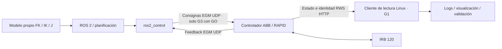

# Conexión del ABB IRB 120 desde Linux: decisión y preparación

Revisión: 20 de octubre de 2026, incorporando las nuevas fotos del FlexPendant y de conexiones. **Estado: inventario parcial confirmado por fotos; ninguna conexión de la PC al controlador físico verificada.** El objetivo inmediato es confirmar RobotWare y preparar la primera lectura. La disponibilidad actual de cable/adaptador debe comprobarse antes de esa prueba. Los drivers no se instalaron ni ejecutaron contra el brazo.

## Recomendación

Elegir como **arquitectura candidata principal ROS 2 + `abb_ros2` + RWS/EGM**. Su adopción queda condicionada a la versión de RobotWare, configuración del controlador, adaptación al IRB 120 y prueba de compilación de una revisión fija. Para la **primera conexión**, empezar por **Ethernet + RWS de lectura**, antes de activar el hardware de `ros2_control`. Son etapas compatibles de la misma arquitectura, no métodos excluyentes.

Las nuevas fotos **confirman 689-1 EGM, 616-1 PC Interface y 623-1 Multitasking** en la lista de opciones del controlador, además de UDP UC Driver. Esto elimina la incertidumbre sobre su presencia en esa captura y refuerza la ruta EGM. La **versión completa de RobotWare sigue desconocida**, igual que el modelo/revisión exactos del gabinete y del computador principal; por eso la compatibilidad del driver aún no está demostrada. Ningún paquete descargado añade licencias al controlador.

Si se confirma **RobotWare 6.07.01 o superior dentro de la rama 6**, interfaz RWS accesible y configuración RAPID apropiada, esta ruta es la mejor candidata para conservar el trabajo existente en ROS 2; la opción EGM ya está documentada en las fotos. Si RobotWare o la configuración no cumplen los requisitos del driver, mantener la lectura de estado si está disponible y evaluar la alternativa RAPID/sockets con el docente. No actualizar RobotWare para resolverlo sin un estudio del sistema del laboratorio.

## Lo que se identificó en las fotos y el proyecto

| Elemento | Observación | Estado y evidencia |
|---|---|---|
| Manipulador | ABB IRB120-3/0.6, serie 120-101516, fabricación 2018-01-10 | Confirmado por placa en `fotos/equipo/856105511_972111242619279_1826443544156678714_n.jpg` |
| Gabinete | Apariencia de IRC5 Compact | Hipótesis visual; falta placa de modelo/revisión |
| FlexPendant | DSQC679, 3HAC028357-001 | Confirmado en foto; no identifica el computador principal ni RobotWare |
| Pieza 3HAC032694-001 | Conector/adaptador fotografiado | No demuestra qué opciones tiene el controlador |
| OMEGA plus SVR-5000W | Regulador de tensión de alimentación | No es el controlador ABB ni un driver ROS |
| Herramienta/TCP físico | Se aprecia brida sin herramienta en la foto general | TCP y herramienta activa del controlador pendientes |
| PC inventariada | Ubuntu 26.04.1, instalación `/opt/ros/jazzy` | Observación local del inventario anterior; compatibilidad del driver sin probar |
| Red de la PC inventariada | En la captura local anterior figuró Wi-Fi `wlo1` y no apareció interfaz Ethernet física | Registro histórico en `evidencias/inventario_pc_2026-10-20.json`; no afirma el estado actual de la red |
| Sistema instalado | `120-101516`; unidad mecánica `ROB_1` visible en las pantallas | Foto `fotos/flexpendant/855156643_1021735353659224_8600621675227135592_n.jpg`; el nombre no identifica la versión de RobotWare |
| Opciones principales | 689-1 EGM, 616-1 PC Interface, 623-1 Multitasking y UDP UC Driver | Confirmadas en `fotos/flexpendant/853082554_2593180977825989_6769481757691654016_n.jpg` |
| Red de servicio | IP `192.168.125.1`, máscara `255.255.255.0`, gateway `None` | Configuración mostrada en `fotos/flexpendant/855960479_2029194091093971_8662650587010659671_n.jpg`; no prueba acceso desde Linux |
| WAN | Configuración DHCP; IP y gateway en blanco en la captura | `fotos/flexpendant/850871225_3669278733235500_3305222871120947565_n.jpg`; no se concluye dirección cero ni ausencia de red |
| Puerto identificado | Etiqueta `X2 Service 10/100` | `fotos/conexiones/850268306_1832902787824998_2294950866819187083_n.jpg`; no identifica el modelo DSQC del computador |
| Estado al tomar las fotos | `Manual`, `Guard Stop`, `Stopped`; indicador `Speed 100%` | Es una observación de las capturas, no el estado actual. El 100% no mide velocidad articular real |
| Backup | Se fotografió el menú de backup | `fotos/flexpendant/850334948_3064085187271613_2972342787603937018_n.jpg`; no demuestra que exista una copia realizada |
| Software propio | Modelo numérico en `hito2/`, paquetes de simulación en `ros2_ws/src/` | No se encontró driver físico integrado en esos paquetes |
| TCP de los modelos | Hito 2: 0.150 m; descripción ROS anterior: 0.100 m | Diferencia que debe resolverse antes de comparar poses o planificar |

La foto completa de opciones también muestra RobotWare Base, 687-1 Advanced Robot Motion, 613-1 Collision Detection, 709-1 DeviceNet Master/Slave, 617-1 FlexPendant Interface, 614-1 FTP SFTP and NFS client, 610-1 Independent Axis, 612-1 Path Offset, 611-1 Path Recovery, 628-1 Sensor Interface, 885-1 SoftMove y 608-1 World Zones. La presencia de estas opciones no confirma que RWS/EGM estén configurados ni que exista una sesión activa. El menú de backup tampoco sustituye la comprobación de una copia y su fecha con el operador.

Las constantes de calibración de la etiqueta del robot no son una pose articular para copiar al modelo. Tampoco se debe cambiar calibración como parte de la conexión.

## Qué driver ROS 2 encontré

**`PickNikRobotics/abb_ros2`** es un driver comunitario de PickNik/Optimax. Es un candidato a lo mencionado en clase; no hay evidencia para asegurar que sea exactamente el repositorio del docente. Incluye:

- `abb_rws_client`: consulta del controlador y servicios RWS. También expone operaciones que modifican estado; su nombre no implica que todo el nodo sea exclusivamente de lectura.
- `abb_hardware_interface`: interfaz `ros2_control` que usa EGM.
- `abb_bringup`: arranque y configuración común.
- Configuración de ejemplo de **IRB 1200-5/0.9**. Ese robot es distinto del **IRB 120-3/0.6** del laboratorio.

La diapositiva titulada «Auditoría de Interfaces» cita como ejemplo condicionado `abb_robot_driver`, que es ROS 1. Esa mención escrita no identifica un driver ROS 2 concreto. Por eso conviene confirmar el enlace que el docente explicó oralmente antes de elegir una rama o instalar paquetes.

Audité la revisión `e6486f7409073cdb2a10d6878bb50191dd50172b` de `rolling`. Las ramas consultadas incluyen `humble`, `iron`, `foxy` y `rolling`; no apareció una rama llamada `jazzy`. La matriz CI de esa revisión prueba Rolling. Esto **no demuestra que Jazzy sea incompatible**, pero impide afirmar que esté validado para nuestra combinación. Su manifiesto de dependencias apunta a ramas móviles: antes de una instalación reproducible hay que fijar también sus revisiones.

El código distingue configuración mediante RWS de configuración desde el URDF, pero desactivar `configure_via_rws` no es una solución demostrada a una versión antigua de RobotWare ni a una licencia ausente. El arranque real inicializa canales EGM y el ciclo `write()` envía consignas: no utilizar un lanzamiento de hardware real como prueba inocua de conectividad.

Fuentes: [repositorio y alcance](https://github.com/PickNikRobotics/abb_ros2), [configuración](https://github.com/PickNikRobotics/abb_ros2/blob/rolling/docs/README.md), [CI revisada](https://github.com/PickNikRobotics/abb_ros2/blob/e6486f7409073cdb2a10d6878bb50191dd50172b/.github/workflows/build_and_test.yaml), [interfaz auditada](https://github.com/PickNikRobotics/abb_ros2/blob/e6486f7409073cdb2a10d6878bb50191dd50172b/abb_hardware_interface/src/abb_hardware_interface.cpp).

También encontré **`hylander2126/irb120_ros2`**, una adaptación comunitaria específica para IRB 120/IRC5 con instrucciones para Ubuntu 24.04/Jazzy y dependencias fijadas. Revisada en `d8673de4cbbba168e2c9b97fa8681c6a1bdcf717`. Es una referencia útil para adaptar el robot, **no compatibilidad certificada con nuestro controlador**. Su arranque incluye un manejador que detiene/reconfigura/inicia EGM y equipos de otra celda (cámaras y sensor de fuerza); no se debe copiar el lanzamiento ni sus direcciones de red directamente. Su autor advierte problemas de apagado de sesión; esas observaciones corresponden a su instalación y requieren evaluación local. [Repositorio del autor](https://github.com/hylander2126/irb120_ros2).

## Comparación de los métodos

| Método | Qué permite | Condición crítica | Decisión para este proyecto |
|---|---|---|---|
| RWS 1.0 desde Python/C++ en Linux | Identidad, versión, opciones reportadas, estados y articulaciones por HTTP | RobotWare 6 compatible, red y cuenta UAS autorizada | Primera prueba G1; no necesita ROS ni una sesión EGM para consultar articulaciones |
| ROS 2 `abb_ros2` + EGM/RWS | Estados y comandos con `ros2_control`; integración posterior con MoveIt | EGM 689-1 confirmado en foto; falta verificar RW ≥6.07.01 dentro de RW6 y adaptar URDF/configuración | Principal candidata; opción presente, compatibilidad y operación aún sin verificar |
| ROS 2 con puente RWS de lectura | Publicar estados reales en ROS sin control de trayectoria | Mismos requisitos RWS y conversión/orden articular comprobados | Etapa intermedia para incorporar estados antes del control; no cumple por sí sola control físico |
| ROS 1 `abb_robot_driver` | RWS y EGM con `ros_control` | Requisitos del driver; es ROS 1/catkin | Referencia técnica, no instalación directa en Jazzy |
| ROS 1 `abb_driver` clásico | Trayectorias mediante RAPID y protocolo SimpleMessage | Programa RAPID y opciones de comunicación compatibles con la versión concreta | Alternativa heredada; añade adaptación a ROS 2 o cambio de entorno |
| ROS 2 `roboticslab-uc3m/abb_egm_driver` | Driver EGM con temas, servicios y acciones | Su README declara RobotWare 7.x/OmniCore | Referencia de otra familia; sin soporte IRC5/RW6 demostrado en la documentación consultada |
| RAPID + sockets propios desde Linux | Intercambiar estados/objetivos; ejecutar movimientos del lado ABB | PC Interface 616-1 y Multitasking 623-1 presentes en foto; verificar instrucciones de esa versión y diseñar programa/protocolo | Arquitectura B si la integración EGM resulta incompatible; validar con docente si satisface integración ROS requerida |
| RobotStudio + controlador virtual | Ensayar comunicación y configuración del controlador ABB sin brazo físico | Windows y RobotWare virtual apropiado; el ejemplo descargado es de otro modelo | Apoyo para aprender y comprobar interfaces; no prueba conexión al brazo físico |
| PC SDK/.NET | Integración con interfaces de ABB desde aplicaciones Windows | Entorno Windows y requisitos de la API/controlador | Poco conveniente como primera ruta para este Linux |
| E/S digitales, buses industriales/PLC | Señales discretas o intercambio industrial según opciones | Hardware, licencias y configuración específicas | No priorizar para obtener seis articulaciones y conectar ROS esta semana |
| USB / transferencia de archivos | Copias y archivos donde el equipo lo permita | Función de transferencia disponible | No sustituye Ethernet ni es un driver de movimiento ROS |

RWS es una API; EGM es la interfaz de intercambio de movimiento; ROS 2 es la plataforma en la PC; RAPID corre en el controlador ABB; RobotStudio es la aplicación de ingeniería. No son cinco instalaciones equivalentes de un mismo programa. RWS puede modificar el robot con otras operaciones: aquí solo se preparó una consulta GET restringida. El sondeo HTTP de estados no se presenta como un lazo de control de tiempo real.

La biblioteca `abb_librws` documenta RWS 1.0 para RobotWare 6, y `abb_libegm` exige EGM 689-1 y RobotWare ≥6.07.01 por cambios de protocolo. No hace falta activar EGM para probar la lectura RWS. Multitasking no se presume obligatorio para toda lectura o para toda configuración de un solo robot: depende de los módulos/tareas elegidos. Fuentes: [abb_librws](https://github.com/ros-industrial/abb_librws), [abb_libegm](https://github.com/ros-industrial/abb_libegm), [driver ROS 1 moderno](https://github.com/ros-industrial/abb_robot_driver), [driver ROS 1 clásico](https://github.com/ros-industrial/abb_driver).

La alternativa [UC3M `abb_egm_driver`](https://github.com/roboticslab-uc3m/abb_egm_driver) ilustra por qué «ABB + ROS 2» no basta para elegir: declara OmniCore/RobotWare 7.x. No se considera intercambiable con una ruta IRC5/RobotWare 6 sin investigación y pruebas adicionales.

## ¿Necesitamos RobotStudio? ¿En qué computadora?

Para consultar RWS desde Linux, **no necesariamente**. Para preparar un controlador virtual, trabajar con copias de seguridad y revisar/configurar RAPID/EGM es una herramienta muy útil y puede ser necesaria en el flujo elegido por el laboratorio.

RobotStudio va en una **PC Windows**, que puede ser la del laboratorio o una segunda computadora. ROS 2 permanece en Linux. No se instala RobotStudio en el controlador ABB. Las notas oficiales de RobotStudio 2026.1 exigen Windows 11 o posterior. La versión de RobotStudio/RobotWare apropiada para la instalación antigua debe elegirse a partir de la versión real y sus restricciones; tener el RobotStudio más reciente no actualiza ni licencia el robot automáticamente. [Notas oficiales consultadas](https://library.e.abb.com/public/c428a5ec678f47fbba35e86865fe7295/RobotStudio%202026.1%20Release%20Notes.pdf).

Para controlador virtual: Linux se comunica con la IP de la PC Windows que lo ejecuta. Para robot físico: Linux se comunica con la IP del controlador ABB. No confundir ambos destinos. La lista de hosts permitidos del controlador virtual es específica de RobotStudio, no una configuración que copiar al IRC5 físico.

## Arquitecturas y señales

**A — candidata principal, una vez aprobada compatibilidad:**



EGM usa UDP y la sesión parte de RAPID en el controlador; la PC responde al intercambio. RWS normalmente usa TCP/HTTP puerto 80 en RW6. El ejemplo de driver usa UDP 6511, que debe coincidir con la configuración de esa celda; no es un valor constatado en este robot.

**B — contingencia ante incompatibilidad de la ruta EGM:** ROS 2 → puente con protocolo explícito → socket/RAPID → controlador ABB; retorno de estado por RWS o el mismo protocolo de sockets. Comandos y confirmaciones deberán incluir identificación de solicitud, unidades, orden articular, límites, errores y cancelación. No basta abrir un puerto TCP para demostrar control. La lógica de movimiento sigue bajo restricciones del controlador y autorización del laboratorio.

## Cómo será la primera conexión, cuando haya cable y acceso supervisado

1. **Completar la identificación sin moverlo.** FlexPendant: ABB → System Info → System properties. Falta fotografiar **RobotWare completo** y la placa del gabinete/computador. Conservar las capturas de opciones y red ya obtenidas, con su fecha si se conoce. No cambiar opciones, calibración ni programas.
2. **Preparar el enlace directo.** Cable Ethernet y puerto/adaptador Linux. La foto de conexiones identifica la etiqueta **`X2 Service 10/100`**; el operador debe confirmar el acceso externo adecuado y su correspondencia con el manual de esa revisión. Esta guía no requiere abrir el gabinete ni reconectar cableado interno. El puerto de servicio IRC5 tiene una red de mantenimiento y DHCP: probar primero asignación automática. No conectarlo a la red institucional como si fuera un puerto de internet.
3. **Comprobar direcciones y ruta.** La pantalla fotografiada confirma servicio `192.168.125.1`, máscara `255.255.255.0` y gateway `None`; comprobar que esa configuración siga vigente. Si hace falta dirección estática de la PC, el manual contempla `192.168.125.2/24` en ese enlace aislado: esa dirección de PC sigue siendo una propuesta, no una configuración ya realizada. No fijar una puerta de enlace en ese adaptador ni alterar el Wi-Fi. La WAN en DHCP es una interfaz distinta; su IP no se ve en la captura.
4. **Ejecutar G1-A:** verificar enlace, IP y que la ruta a la IP ABB use la interfaz Ethernet correcta. Si la ruta sale por Wi-Fi, detener el diagnóstico y corregir el enlace. No buscar el robot en toda la red universitaria.
5. **Ejecutar G1-B:** una consulta de identidad y estado RWS con usuario UAS autorizado. Comparar nombre/sistema, versión y seis ejes con el FlexPendant; distinguir controlador virtual/físico. Guardar evidencia y cualquier fallo. No iniciar RAPID, motores, EGM ni controladores de trayectoria.
6. **Después:** probar publicación de estado en ROS 2, nombres y conversión grados→radianes. Solo tras validar modelos y contar con GO pasar a configuración y pruebas de movimiento. Conectividad no equivale a seguridad ni a trayectoria autorizada.

Referencia de red: [manual oficial RobotStudio, 3HAC032104](https://library.e.abb.com/public/3c5f83f09b25420bae42e70b3df5bce9/3HAC032104%20OM%20RobotStudio-en.pdf). Las ubicaciones y funciones de los puertos cambian entre computadores IRC5; no abrir el gabinete energizado ni desconectar cables de robot/FlexPendant para experimentar.

### Herramienta preparada para G1

Desde la carpeta raíz del proyecto:

```bash
# Solo inventario local: no contacta al controlador.
python3 scripts/abb_lectura_rws.py --output docs/conexion_abb/evidencias/inventario_pc.json
```

Para la futura prueba supervisada, sustituir los dos valores por IP y usuario **verificados**:

```bash
python3 scripts/abb_lectura_rws.py --host IP_VERIFICADA --user USUARIO_UAS --output docs/conexion_abb/evidencias/g1_rws.json
```

La contraseña se pide sin mostrarla y no se guarda. El ejemplo contiene marcadores, no es un comando listo para ejecutar. Requiere Python y `requests` (ver `requirements.txt`). No instalar dependencias ROS para realizar esta primera comprobación.

El diagnóstico solo permite seis recursos GET predefinidos, comprueba identidad RWS antes de consultar el resto y no sigue redirecciones. Admite respuestas JSON/XHTML de RWS 1.0, exige seis valores articulares finitos y no convierte errores en ceros. No implementa RWS 2.0/RW7. Una respuesta HTTP puede pertenecer a un controlador virtual: la identidad física queda expresamente pendiente hasta contrastarla con el operador.

| Resultado | Interpretación correcta |
|---|---|
| Sin Ethernet / sin ruta directa | No se ha establecido el enlace al robot |
| Timeout | Dirección, enlace, ruta, servicio o filtrado por verificar; no demuestra ausencia de licencia |
| HTTP 401/403 | El servicio responde; falta revisar autenticación o permisos |
| HTTP 404 / contenido distinto | No confirma el recurso/versión RWS esperada |
| Identidad RWS y ejes válidos | Evidencia de lectura; falta contrastar con el equipo físico |
| RWS correcto, EGM sin paquetes | Revisar por separado EGM, RAPID y destino UDP; RWS no prueba EGM |

Pruebas offline: `python3 -m unittest discover -s scripts/tests -v`. Ocho pruebas pasan con respuestas simuladas; **no son pruebas de hardware**.

## Trabajo de esta semana y límites de la recomendación

El inventario local anterior registró Ubuntu 26.04.1 y ROS Jazzy. El objetivo de plataforma binaria de Jazzy es Ubuntu 24.04: no puedo prometer que compilar aquí el driver funcione sin adaptación. Para reproducibilidad, evaluar primero un entorno Ubuntu 24.04/Jazzy separado; contenedor o PC de laboratorio son opciones a estudiar. Un contenedor no resuelve licencias, red, latencia ni autorización. No se modificó el entorno existente. [REP-2000 oficial](https://github.com/ros-infrastructure/rep/blob/master/rep-2000.rst).

Antes de adoptar un driver real: revisar dependencias/credenciales, adaptar URDF y `ros2_control` al IRB 120, confirmar nombres y límites de juntas, base/TCP, y verificar apagado de EGM. No usar una estación Pack-and-Go IRB1200 como configuración física IRB120. Los paquetes de simulación del proyecto y el modelo DH pueden reutilizarse, pero su acuerdo numérico no constituye validación de geometría ABB independiente cuando el URDF procede del mismo DH.

Los entregables y pendientes concretos están en `plan_semana_12.md`, `gate0_inventario.csv` y el `model_manifest.yaml` de la raíz. Las métricas de validación física permanecen vacías. La próxima decisión depende de **RobotWare completo + revisión de controlador + driver que el docente pretenda usar**. Las opciones principales ya están documentadas; aún falta comprobar su configuración y los permisos RWS/UAS. Cable/adaptador se requiere para la futura prueba; su disponibilidad actual debe confirmarse.

## Material del docente actualizado

Se descargaron los seis documentos PDF y sus seis fuentes TEX de W12-S01 en `archivos que hay que presentar/actualizacion_semana_12/`, con origen y verificaciones en `origen_descargas.json`. La sesión distingue Gate 0 documental, Gate 1 lectura sin movimiento, Gate 2 validación FK/IK/J, Gate 3 movimiento con GO y Gate 4 tarea repetible. Integra III/IV como ECI-3/4; no confundirlo con haber superado los gates por tener una simulación.

La rúbrica propuesta distribuye: auditoría/compatibilidad 20%; modelos propios/validación 25%; integración ROS–ABB 25%; seguridad/reproducibilidad 20%; documentación/defensa individual 10%. El calendario es tentativo: W12 G0, W13 G1/G2 y contingencia, W14 G2/G3 condicionado, W15 tarea, W16 cierre EC; EF posterior con nuevo escenario. La nueva fecha exacta de Hito 2 no figura en los documentos consultados. [Diapositivas W12-S01](https://github.com/berquiroga/planificacion-UCB/blob/main/2-2026/IMT342/Semana_12/sesion_01/w12_s01_slides.pdf), [guía autónoma](https://github.com/berquiroga/planificacion-UCB/blob/main/2-2026/IMT342/Semana_12/sesion_01/w12_s01_guia_autonoma_bitacora.pdf).

La guía limita el trabajo autónomo a investigación/software y exige supervisión/protocolo para conectarse físicamente. No se ejecutaron conexiones al brazo ni cambios de red, programas o motores durante esta revisión.

Las fuentes archivadas y los errores de descarga están registrados en `fuentes/origenes*.json`. Un archivo que figura con error de descarga no se presenta como un manual local disponible.
