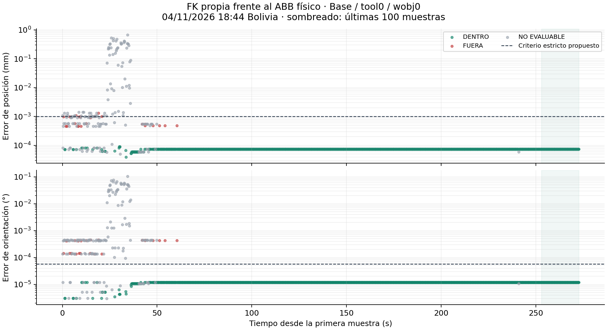

# Comparación física FK propia / ABB · 04/11/2026

Captura: 2026-11-04T18:44:12.836363-04:00. Fuente: `salidas/prueba_comunicacion/comunicacion_20261104_223936_186467Z_fk.jsonl`. El proceso del usuario estaba activo; se analizaron sus lecturas reales, sin solicitar otra contraseña ni iniciar un segundo puente.

## Resultado

La conexión Ethernet fue comprobada con 3/3 respuestas, 0 % de pérdida, PC `192.168.125.203/24` y controlador `192.168.125.1`. El panel FK local respondió con datos recientes. La FK se recalculó desde las muestras originales usando el código actual, con diferencia máxima respecto al registro de 0.

Última muestra: secuencia **1365**, estado **DENTRO**, ángulos antes/después iguales. Error de posición **7.45114315036e-05 mm**, orientación **1.17847589093e-05°** (2.05682844521e-07 rad).

Ángulos ABB (grados): `[-73.2051544189453, -12.1486206054688, 9.91144466400146, 91.8839874267578, 31.7478084564209, -134.498596191406]`.

| Eje | FK propia (mm) | ABB (mm) | Propia − ABB (mm) |
|---|---:|---:|---:|
| X | 123.900516901 | 123.9005000 | 0.000016901 |
| Y | -279.467828976 | -279.4678000 | -0.000028976 |
| Z | 639.323533467 | 639.3236000 | -0.000066533 |

## Conjunto completo y tramo final

Se congelaron **1365 muestras**, entre `2026-11-04T22:39:39.908733+00:00` y `2026-11-04T22:44:12.693478+00:00`. Estados: `{'NO_EVALUABLE': 163, 'FUERA': 25, 'DENTRO': 1177}`. Los agregados siguientes usan únicamente las **1202 muestras comparables**, incluidas las que están FUERA.

| Métrica | Mediana | P95 | Máximo |
|---|---:|---:|---:|
| Error de posición (mm) | 7.45114315036e-05 | 7.45114315036e-05 | 0.00133388625123 |
| Error de orientación (°) | 1.17847589093e-05 | 1.17847589093e-05 | 0.000454415395212 |

Las últimas **100 muestras** cubren **19.80 s** y todas tienen estado **DENTRO**. El vector articular es el mismo en todo ese tramo y no cambió entre las lecturas antes/después. Posición máxima: **7.45114315036e-05 mm**; orientación máxima: **1.17847589093e-05°**. Son lecturas repetidas de una postura, no 100 posturas independientes.

Los criterios siguen en **0.001 mm** y **10⁻⁶ rad = 0.0000572958°**, como propuesta numérica estricta. No se cambió el algoritmo ni se ampliaron tolerancias para este análisis.

Los resultados FUERA del tramo inicial se conservan. Algunos presentan ángulos inicial/final iguales pero una pose ABB diferente entre muestras: eso no demuestra por sí solo un error geométrico ni permite atribuirlos a movimiento, asincronía o redondeo sin otra prueba. La adquisición es secuencial y no garantiza simultaneidad. El tramo final observado sí pasa el criterio en todas sus muestras.

## Alcance y comprobación de modelos

Rangos observados por articulación (grados): `[8.927116394042898, 12.35330867767334, 15.55109500885009, 0.0, 0.00042915344239702335, 0.00044250488298303026]`. Se cambiaron principalmente J1–J3; J4–J6 no tuvieron una variación suficiente para una campaña global. Falta repetir en posturas distintas que ejerciten esos ejes, dejando reposar el brazo antes de medir.

Hito 1 frente a Hito 2, recalculados con estos mismos ángulos: diferencia máxima de posición **0 mm** y orientación **0 rad**. Frente a la geometría ROS-Industrial local independiente: **2.28878e-13 mm**, **3.14115e-16 rad**. Estas comprobaciones numéricas adicionales no sustituyen la referencia física ABB.

Se compara `tool0` en `Base`, con `wobj0`. Esto no calibra la punta de la pinza ni mide exactitud mecánica absoluta. El uso explícito de `ignore=1` queda registrado.

Modelo: `/home/marcelo767/Documentos/robotica/robotica-IMT342/2-2026/IMT342/equipo/proyecto/ros2_ws/src/irb120_hito1/irb120_hito1/kinematics/dh.py`. SHA256: `5124f4ef749e2529ef2a4cff379693d932a84f4acf79e02d0d69f71fe4c0b37f`.

## Evidencias congeladas

- [Muestras originales JSONL](fk_real_2026-11-04_224412Z_muestras.jsonl) · SHA256 `1b67f5871ace03c4fd45d35a9f9e34431a5bec23bd2e6b9a0a0fc471e66f667c`.
- [Resumen y última muestra completos](fk_real_2026-11-04_224412Z_resumen.json).
- [Errores por muestra CSV](fk_real_2026-11-04_224412Z_errores.csv).
- [Gráfico PNG](fk_real_2026-11-04_224412Z_errores.png) y [SVG](fk_real_2026-11-04_224412Z_errores.svg).

El color del gráfico indica el veredicto conjunto de posición y orientación; un punto puede estar bajo el umbral de posición y ser rojo por su orientación. Las muestras grises no se incluyen en los agregados comparables.

