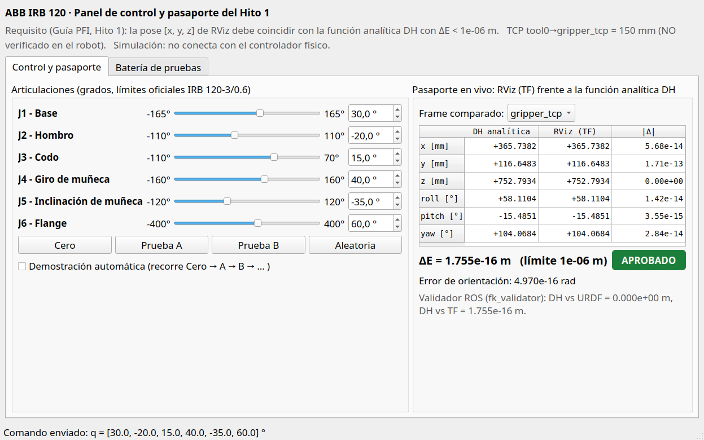
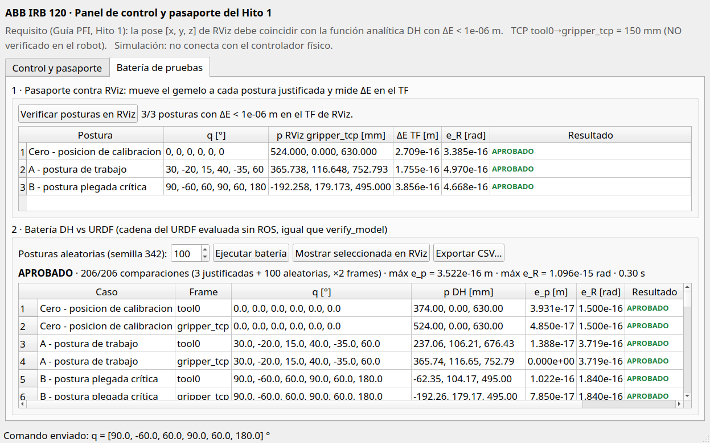

# Hito 1: modelo y simulación ROS 2

Esta área contiene el trabajo de simulación del IRB 120. Los comandos de esta página operan los nodos de simulación del proyecto; no constituyen conexión al controlador físico.

Requisito (Guía PFI, sección 4): paquete de ROS con el URDF modular del ABB IRB 120 acoplado con la pinza; la pose `[x, y, z]` de RViz debe coincidir con la función analítica en Python con `ΔE < 1e-6 m`. Estado por requisito en la [auditoría del 22/10/2026](auditoria_2026-10-22.md).

## Documentos y resultados

- [Modelo cinemático](modelo_cinematico.md), [trazabilidad](trazabilidad.md), [resultados](resultados.md) y [defensa](guion_defensa.md).
- [Manual PDF](../../entregables/hito1/pdf/Guia_Practica_Hito1_IRB120_6_Juntas_CORREGIDA.pdf) y [presentación](../../entregables/hito1/presentation/Defensa_Hito1_IRB120_6_Juntas_FINAL.pptx) (11/09/2026). **Desactualizados:** describen un URDF sin pinza, sin `collision`, 12 pruebas, TCP de 0.100 m y el panel Tk anterior. El código actual tiene pinza fija, meshes `collision` del CAD, TCP de 0.150 m, panel Qt y 38 pruebas. Prevalecen estos `.md` hasta regenerar ambos archivos.
- [Paquete ROS y modelos](../../ros2_ws/src/irb120_hito1/README.md).

## Construcción y visualización

Desde la raíz del proyecto, en una terminal sin Miniconda activo (el historial documenta conflictos con `rclpy`):

```bash
source /opt/ros/jazzy/setup.bash
cd ros2_ws
colcon build --symlink-install
source install/setup.bash
ros2 launch irb120_hito1 display.launch.py
```

El archivo de lanzamiento es `display.launch.py`; no existe `irb120.launch.py`. Se abren RViz y el **panel de control** (Qt, el mismo toolkit de RViz):



- **Control y pasaporte:** seis deslizadores con caja numérica (0.1°), límites oficiales del IRB 120-3/0.6, botones `Cero`, `Prueba A`, `Prueba B`, `Aleatoria` y demostración automática. A la derecha, la pose `base_link → gripper_tcp` (o `tool0`) del TF que dibuja RViz frente a la función analítica DH, con `ΔE` y el indicador `APROBADO` contra `1e-6 m`.
- **Batería de pruebas:** (1) mueve el gemelo a las posturas justificadas y mide `ΔE` sobre el TF de RViz; (2) batería DH vs URDF con posturas aleatorias (semilla 342), exportable a CSV; cualquier fila se puede mostrar en RViz.



Variantes del lanzamiento:

```bash
# Demostración automática sin panel (equivale a marcar la casilla del panel)
ros2 launch irb120_hito1 display.launch.py demo_motion:=true
# Sin RViz o sin panel
ros2 launch irb120_hito1 display.launch.py use_rviz:=false
ros2 launch irb120_hito1 display.launch.py use_slider_gui:=false
# Solo el panel, con el resto de nodos ya en marcha
ros2 run irb120_hito1 control_panel
```

Desde otra terminal con los mismos entornos también puede enviarse una postura; el panel la refleja:

```bash
ros2 topic pub --once /irb120/joint_commands_deg std_msgs/msg/Float64MultiArray \
  "{data: [30.0, -20.0, 15.0, 40.0, -35.0, 60.0]}"
```

Las entradas son grados para `joint_1` a `joint_6`; valores fuera de rango se saturan a los límites oficiales. Detener con `Ctrl+C`.

## Pruebas y pasaporte desde la terminal

```bash
colcon test --packages-select irb120_hito1
colcon test-result --all          # 38 tests, 0 errors, 0 failures
ros2 run irb120_hito1 verify_model   # 206 comparaciones DH vs URDF, APROBADO
```

El validador ROS publica `/irb120/fk_tf_position_error_m` (DH contra el TF de RViz, el pasaporte) y `/irb120/fk_position_error_m` (DH contra la cadena URDF). El launch valida el marco `gripper_tcp`.

Launch, pruebas y `verify_model` leen `urdf/irb120.urdf`, la expansión del Xacro. Si se cambia el Xacro o `config/tcp.yaml` hay que regenerarlo (`xacro urdf/irb120.urdf.xacro -o urdf/irb120.urdf`); una prueba falla si no coinciden.

El TCP (`gripper_tcp`) está a 0.150 m de la brida sobre Z de `tool0`, igual que en el Hito 2. El valor se define solo en [`config/tcp.yaml`](../../ros2_ws/src/irb120_hito1/config/tcp.yaml), que leen el Xacro, la DH y el validador; **no está medido en la pinza real** (`verified_on_robot: false`). El CAD del brazo procede de ROS-Industrial; ver [NOTICE](../../ros2_ws/src/irb120_hito1/meshes/NOTICE.md).

## Puente hacia Hitos 3/4

Los Hitos 3/4 se evalúan como ECI-3/4 ([requisitos](../hitos_3_4/REQUISITOS_ECI34.md)). El Gate 2 compara FK/IK/J propios contra una referencia y solo admite el cálculo del error si coinciden marco base, TCP, `joint_order`, unidades, sentidos y offsets.

Se reutiliza del Hito 1:

- **Modelo propio:** tabla DH de `kinematics/dh.py` (la misma de `hito2/irb120/dh.py`) y URDF con equivalencia DH-URDF verificada (`< 1e-6 m`, error observado del orden de `1e-16 m`). El paquete `irb120_hito2` importa `JOINT_NAMES`, `DH_PARAMETERS`, `forward_kinematics_tcp`, `urdf_chain` y los meshes `collision` de este paquete.
- **Marco base:** `base_link`, en el pie del robot (J2 a 0.290 m sobre él). Coincide con `base_frame` de [`model_manifest.yaml`](../../model_manifest.yaml).
- **`joint_order`:** `joint_1` … `joint_6`, igual que el manifiesto.
- **Unidades:** rad y m en el modelo y en `/joint_states`; grados solo en la interfaz `/irb120/joint_commands_deg` y en el panel. RPY URDF: `Rz(yaw)·Ry(pitch)·Rx(roll)`.
- **TCP:** `gripper_tcp` (`tcp_frame` del manifiesto) como traslación pura de 0.150 m sobre Z de `tool0`, común a Hito 1 y Hito 2 desde `config/tcp.yaml`; pendiente de medir en la pinza real.
- **Referencia independiente:** en `tool0` el modelo coincide con el modelo oficial ROS-Industrial (`hito2/irb120/rosi_model.py`) en 106 posturas, `e_p ≤ 2.5e-16 m` ([evidencia CSV](../conexion_abb/evidencias/fk_hito1_vs_rosi.csv), `scripts/comparar_fk_hito1_rosi.py`).
- **Método de comparación:** `e_p = ‖p_DH − p_URDF‖₂` y `e_R` geodésico, ya implementados en `position_error_m` y `rotation_error_rad`.

Queda pendiente para el Gate 2:

- contrastar sentidos de giro, offsets de cero y límites con una referencia ABB (RobotStudio o lectura del controlador); `kinematics_reference` sigue en `null` en el manifiesto;
- relacionar `base_link` con el marco base/world del controlador y `gripper_tcp` con el `tooldata` real de la pinza (CAD y TCP medidos);
- comparar contra `joint_states` originados en el ABB (Gate 1), no solo contra el propio URDF: la equivalencia DH-URDF demuestra coherencia interna, no exactitud frente al robot real;
- la Jacobiana y la IK viven en el Hito 2; el Hito 1 solo aporta FK.
