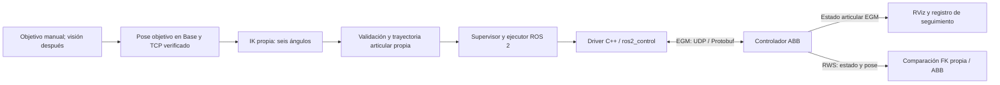

# Plan de avance: validación FK → EGM articular → IK propia → visión

Fecha: **03/11/2026**. Rama de trabajo: `proyectoHito3y4`, revisión base `888abe7` con cambios locales posteriores. Este documento planifica el desarrollo; no configura el ABB, no habilita EGM ni autoriza movimiento físico.

**Actualización 04/11:** se incorporó [irb120_control](../../ros2_ws/src/irb120_control/README.md): controles nativos RViz J1–J6, LSPB propio, guardas y EGM UDP de prueba. Esta primera implementación usa Python con watchdog de ciclo/heartbeat, esquema Protobuf de abb_robot_client y simulador local; no afirma tiempo real garantizado ni reemplaza la futura auditoría del driver C++. RWS/TF/FK ya tienen evidencia física parcial. EGM y la plantilla RAPID siguen pendientes de validar en el controlador. Ver [comandos de laboratorio](../conexion_abb/COMANDOS_LABORATORIO.md).

## 1. Decisión y punto de partida

Usaremos como **ruta candidata EGM Position Guidance en modo articular**, para que la IK propia produzca seis ángulos y la computadora genere su trayectoria. El controlador ABB conserva el control de sus motores. El primer ensayo desde PC será articular, sin depender de IK ni de visión. La lectura RWS actual se conserva para diagnóstico y comparación de pose.

| Elemento | Estado comprobable hoy |
|---|---|
| ABB IRB120-3/0.6, unidad `ROB_1` | Identificado en el proyecto y en las lecturas del controlador |
| RobotWare 6.12.01.00 y opción 689-1 EGM | Registrados en [lectura RWS real](../conexion_abb/evidencias/g1_rws_2026-10-29_sanitizado.json); satisfacen los requisitos declarados por la biblioteca candidata |
| RWS → ROS → TF | [28 muestras estacionarias sincronizadas](../conexion_abb/evidencias/verificacion_rws_ros_tf_2026-11-03.json), sin comandos físicos |
| Seguimiento físico en RViz | Éxito reportado por el usuario el 03/11 |
| Nueva comparación automática FK propia/ABB | Software comprobado con simulador; ensayo físico de varias posturas pendiente |
| IK, Jacobiano y LSPB propios | Disponibles en `hito2/irb120/`; necesitan adaptación y validación para ejecución física |
| Sesión/control EGM | No demostrado; driver todavía sin compilación local validada |
| Backup, TCP físico y condiciones de movimiento | Pendientes de verificación/documentación; `movement_authorized: false` en el manifiesto |

La biblioteca [abb_libegm, revisión fijada](https://github.com/ros-industrial/abb_libegm/blob/2c9350abfb67131cae796805fed8cd6eeb2ab7f9/README.md) exige RW ≥6.07.01 y la opción 689-1. Cumplir esos dos requisitos permite investigar esta ruta, pero no demuestra compatibilidad de toda la instalación.

## 2. Qué aporta EGM y qué construiremos nosotros

ABB distingue **Position Stream**, que entrega estado, de **Position Guidance**, que permite guiar el movimiento. EGM usa UDP y Protobuf. En modo articular intercambia ángulos en grados; nuestra matemática y ROS usarán radianes, con conversión en el adaptador. Guidance no proporciona planificación de trayectorias: la secuencia suave de referencias será responsabilidad de nuestra integración. El ciclo se configura en el controlador; el manual describe periodos nominales de 4 ms y múltiplos, con diferencias entre sistema físico y virtual. No se ha medido esa cadencia en esta PC. Fuentes: [manual ABB RW6, 3HAC073319-001 revisión F, §§1.2–1.3, 2.6, 3.1](https://library.e.abb.com/public/f63dc4031d194a58be058eb657441180/3HAC073319%20AM%20Externally%20Guided%20Motion%20RW6-en.pdf).

Por ello proponemos esta arquitectura, todavía sin implementar la salida física:

Para las primeras pruebas, los objetivos articulares entran directamente al planificador, antes de incorporar la IK. Un objetivo articular contiene siempre seis valores: al probar un eje, los otros cinco conservan sus referencias iniciales.

La visión y la IK podrán ejecutarse en Python. El intercambio cíclico se apoyará en el driver C++ candidato. Ni el navegador, ni RViz, ni el lector HTTP de 5–10 Hz serán responsables de sostener el ciclo EGM. La frecuencia de refresco de pantalla será independiente.

No enviaremos inicialmente poses mediante EGM Pose: queremos comprobar la IK propia mediante las consignas articulares que genera. Tampoco se implementará por ahora seguimiento visual continuo; primero se llegará a objetivos estáticos.

## 3. Secuencia de pruebas y condiciones para avanzar

### P1 · Cerrar la validación física de FK

Usar la [herramienta ya preparada](../conexion_abb/VALIDACION_FK_EN_VIVO.md), en `Base`, `tool0`, `wobj0`. El operador posiciona con FlexPendant y deja el brazo quieto antes de evaluar. Propuesta de campaña: **10 posturas distintas y al menos 20 muestras válidas por postura**, cambiando las seis juntas a lo largo de la campaña dentro de posiciones aprobadas por el operador.

Guardar ángulos originales, pose ABB, pose propia, errores de posición/orientación, ventana de adquisición y versión del modelo. Resumir mediana, percentil 95 y máximo por postura. No contar lecturas fallidas, antiguas o no evaluables como aprobadas.

Los límites actuales son **0.001 mm y 10⁻⁶ rad**, propuestos como criterio numérico estricto, sin requisito oficial del docente. Pueden resultar inferiores a la concordancia entre el modelo nominal y el modelo del controlador. No se ampliarán automáticamente. Si no se cumplen, investigar marcos, signos, offsets, resolución y parámetros/calibración antes de decidir y documentar un criterio justificable con el docente. Una comparación contra ABB no mide por sí sola exactitud física externa.

**Salida de P1:** informe reproducible que establezca el error observado y el criterio aceptado, con mapeo de los seis ejes y marcos contrastados en varias posturas. Una sola postura concordante no cierra esta etapa. Si cambia la matemática, repetir la campaña afectada y verificar su equivalencia entre Hito 1, Hito 2 y URDF.

### P2 · Preparar EGM y el software sin movimiento físico

Actividades de ingeniería que pueden prepararse mientras se recogen las muestras FK:

- Auditar el driver candidato [PickNik/abb_ros2, revisión e6486f7](https://github.com/PickNikRobotics/abb_ros2/tree/e6486f7409073cdb2a10d6878bb50191dd50172b), sus dependencias y su adecuación a Jazzy/IRB120. Sus ejemplos IRB1200 no son configuración de nuestro robot.
- Fijar commits y demostrar compilación en un entorno separado y reproducible. La instalación Ubuntu 26.04/Jazzy/Python 3.12 actual aún no demuestra que compile este driver. Evaluar primero un entorno Ubuntu 24.04/Jazzy aislado, conservando la lectura que funciona.
- Definir seis ejes, nombres/orden, signos, unidades, límites efectivos del ABB y el comportamiento de J6. No aplicar a consignas la equivalencia angular módulo 360 usada en visualización: una vuelta adicional es movimiento real.
- Revisar la trayectoria LSPB propia: sus velocidades predeterminadas y aceleraciones supuestas son parámetros de simulación. Los límites de ensayo físico serán explícitos y específicos del laboratorio. Auditar la interpolación de `ros2_control` para evitar que altere el perfil o produzca excesos entre muestras.
- Probar con simulador/mock: inicialización desde estado actual, rechazo de NaN/ejes incompletos/objetivos antiguos, saltos, límites y colisiones; cancelación y pérdida de datos. Incluir estado inicial diferente de cero.
- Preparar una estación virtual IRB120/RW6 equivalente si se dispone de RobotStudio. Un mock valida software; el controlador virtual añade validación del protocolo/RAPID. Documentar cuál se utilizó.

**Antes de aplicar configuración al ABB**, obtener respaldo completo comprobado y revisar con el operador: módulo/tarea RAPID existente, dispositivo UDPUC, parámetros EGM, herramienta/carga activa, procedimiento de entrada/salida y parada. Revisar las restricciones de inicio de EGM en el manual correspondiente a RW6.12, sin copiar movimientos iniciales de ejemplos.

La ficha de red registrará interfaz/puerto físico permitido, IP del controlador, IP estable o confirmada de la PC, destino UDP, puerto y periodo. La lectura funciona por X2 Service a `192.168.125.1`, pero falta comprobar que la ruta/configuración elegida sirva para EGM. La IP recibida por DHCP puede cambiar; `6511` es un ejemplo documental, no un puerto ya comprobado en este ABB.

**Salida de P2:** software compilado, prueba offline registrada y configuración propuesta revisable. No se marca EGM físico como funcional por compilar.

### P3 · Recibir estado EGM antes de habilitar Guidance

Con la configuración revisada y el procedimiento del laboratorio, probar **Position Stream** y un receptor sin consignas de corrección. El programa RAPID de ensayo debe revisarse para que no incluya movimientos tomados de ejemplos. Arrancar una sesión en el controlador ya requiere un procedimiento distinto al GET actual.

Identificar estado **medido** y estado **planificado**; publicar el medido para RViz. Comparar los seis ejes con RWS/FlexPendant en reposo. Registrar cadencia recibida, variación entre paquetes, secuencias perdidas y antigüedad con reloj monotónico de la PC. No interpretar diferencias entre relojes no sincronizados como latencia unidireccional.

**Salida de P3:** recepción física identificada, continua y con unidades/mapeo correctos. Si el adaptador candidato responde automáticamente con referencias, no se lo usará como receptor pasivo sin auditar/deshabilitar esa salida.

### P4 · Primera habilitación: mantener la postura inicial

Después de P1–P3 y del GO específico de laboratorio, tomar una muestra EGM reciente y construir `q_ref = q_actual` para las seis juntas. Verificar que no hubo cambio de postura durante el armado; inicializar la referencia una vez y mantenerla fija. **No realimentar la consigna copiando continuamente la posición medida.**

No se enviará un vector de ceros ni se usará `HOME_Q` como arranque físico. El HOME matemático de Hito 2 tiene J5=0 y singularidad de muñeca. La postura inicial será elegida por el operador.

El [driver auditado](https://github.com/PickNikRobotics/abb_ros2/blob/e6486f7409073cdb2a10d6878bb50191dd50172b/abb_hardware_interface/src/abb_hardware_interface.cpp) inicializa la posición de comando desde el estado recibido al activarse y su método `write()` transmite referencias. Hay que comprobar también arranques, reinicios y cualquier otra capa que pueda sustituir ese comando.

**Salida de P4:** mantenimiento sin salto de referencia y parada normal comprobada, dentro de los umbrales fijados en la ficha de ensayo. Cualquier fallo invalida el armado; reconectar no reanuda movimiento automáticamente.

### P5 · Mandar un eje cada vez desde la PC

Ejecutar ensayos separados J1 → J2 → … → J6; se revisa el resultado de cada eje antes del siguiente. El orden final puede cambiar según postura y espacio disponible, por decisión del operador.

Cada ensayo parte de `q0` medido y detenido. Solo la junta elegida recibe un desplazamiento pequeño `δ` aprobado para esa postura, con rampa de aceleración, velocidad y frenado limitadas. Los otros cinco objetivos permanecen fijos. El retorno a `q0` será otra trayectoria revisada; no una oscilación automática indefinida. No se ofrecen todavía botones o comandos físicos ejecutables.

El panel mostrará por eje **ángulo solicitado, referencia interpolada enviada, ángulo medido y error de seguimiento**; también estado de sesión, antigüedad, frecuencia y motivo de parada. La diferencia directa entre objetivo final y ángulo actual durante el recorrido no se confundirá con error del controlador.

**Salida de P5:** seis ensayos registrados con sentido/escala correctos, cinco referencias conservadas en cada ensayo, seguimiento y asentamiento dentro de umbrales acordados, y cancelación comprobada. Si falla un eje se detiene la campaña y se investiga.

### P6 · Trayectoria coordinada sin IK

Repetir el procedimiento con dos o más articulaciones, entre configuraciones conocidas y aprobadas, usando LSPB propio. Comprobar toda la trayectoria: límites de posición/velocidad/aceleración, continuidad, singularidades y espacio libre del brazo y herramienta. RViz permite inspección visual; no es por sí solo un verificador de colisiones.

**Salida de P6:** seguimiento coordinado reproducible, llegada y parada registradas. Alcanzar dos extremos válidos no demuestra que el recorrido intermedio sea válido ni rectilíneo en el espacio cartesiano.

### P7 · Incorporar nuestra cinemática inversa

Primero en software: usar poses ABB guardadas en P1 como entrada a la IK y comprobar `FK(IK(T)) ≈ T`, ramas, límites y Jacobiano. La IK puede devolver otra rama correcta; no tiene que reproducir los mismos seis ángulos del ABB. Para ejecución seleccionaremos una rama cercana a `q_actual`, continua y admisible.

Antes de conectarla al ejecutor:

- Alinear la FK de Hito 1 usada por el validador con la FK/IK de Hito 2. Usar el mismo contrato de Base, herramienta, unidades y geometría, sin duplicar una tercera implementación.
- Crear una selección estricta para hardware. `hito2/irb120/pieper.py:rank_candidates` actualmente puede relajar margen a límites y filtro de singularidad si faltan candidatos. La ruta física rechazará esos casos; documentar también la escala/convenio del Jacobiano al definir umbrales, pues su SVD mezcla componentes lineales y angulares.
- Resolver el TCP real y su transformación completa respecto a `tool0`; los 150 mm del modelo son una suposición, no una calibración. Verificar herramienta/carga configuradas. Para comprobar solo la brida se seguirá usando `tool0`, sin atribuir ese resultado a la punta de la pinza.
- Validar también el camino desde el estado actual, no solamente la solución final. Rechazar objetivos inalcanzables, ambiguos o que requieran una rama/recorrido no aprobados.

La primera ejecución usará una **pose objetivo introducida manualmente**, cercana y revisada, con orientación explícita. El ejecutor recibe una trayectoria articular validada, no la pose directamente. Medir seguimiento articular y error de pose final con el brazo detenido.

**Salida de P7:** objetivos cartesianos manuales resueltos por IK propia y ejecutados por EGM articular, con evidencia de llegada y continuidad de rama.

### P8 · Visión como fuente del objetivo

Empezar con cámara y objeto estáticos. Un píxel `(u,v)` no determina una ubicación 3D: necesitamos profundidad o una geometría/plano calibrado. Tampoco define toda la orientación de la pinza; al principio la fijaremos según la tarea.

Para cámara fija, calibrar intrínsecos y `T_Base_Camara`; después:

`p_Base = T_Base_Camara · p_Camara`

Si la cámara está montada en el brazo se necesitará calibración mano-ojo y la transformación que depende de la postura. El algoritmo entregará objetivo con marco, unidades, instante y confianza. Se rechazarán detecciones antiguas, sin profundidad válida o fuera de la región admitida.

Primero mostrar en RViz la detección y la pose propuesta; luego aprobar un objetivo estático e ingresar por la misma ruta validada en P7. Definir puntos de aproximación y retirada antes de probar agarre. La pérdida de visión no generará ceros ni un objetivo nuevo. Seguimiento continuo de objetos será una ampliación posterior con su propio ensayo.

**Salida de P8:** una tarea repetible de objetivo estático, con transformaciones/calibración documentadas y registro del error final.

## 4. Tres errores diferentes

| Métrica | Comparación | Para qué sirve |
|---|---|---|
| Error FK de modelo | `FK_propia(q_medido)` frente a pose ABB comparable, en reposo | Validar matemática y marcos |
| Error de seguimiento articular | `q_referencia(t)` frente a `q_medido(t)` con alineación temporal declarada | Validar ejecución de trayectoria y dinámica de seguimiento |
| Error final de tarea | Pose objetivo frente a pose final detenida, mismo TCP/Base | Verificar llegada al objetivo; con visión añade errores de calibración/detección |

La tolerancia numérica estricta de P1 **no se transfiere automáticamente** a seguimiento EGM ni a visión. El docente/laboratorio debe acordar los valores operativos según evidencia y tarea. Un error de pose calculado por el ABB sigue siendo una referencia interna; exactitud física absoluta requiere medición externa.

Para seguimiento guardaremos error por junta, máximo/RMS, error final y tiempo de asentamiento. La comparación entre referencia enviada y medida incluye filtros/retardo del controlador; se declarará qué tiempo se alinea. No se ajustará un PID adicional para ocultar errores antes de entender esta cadena.

## 5. Condiciones del ejecutor y tratamiento de fallos

Estas son especificaciones pendientes de implementar y probar, no funciones existentes:

- Solo un propietario de comandos y una fuente de estado real publicada por ejecución. RWS y EGM usan espacios de nombres separados; la trayectoria prevista se visualiza separada del estado medido.
- Estado inicial `DESCONECTADO` → `ESTADO_VALIDO` → `LISTO` → `ARMADO_EN_REPOSO` → `EJECUTANDO`. `PARANDO` y `FALLO` cancelan la ejecución. Toda recuperación vuelve a requerir estado reciente y armado explícito.
- La interfaz no arma ni inicia movimiento al abrirse, arrancar el equipo o reconectarse. Un comando repetido no se ejecuta dos veces; usar identificador, vigencia y respuesta de aceptación/rechazo.
- Validar seis valores finitos, límites, referencia inicial, vigencia del objetivo/trayectoria, origen, periodo y continuidad. No convertir datos ausentes a cero ni continuar un plan vencido.
- El control de vigencia estará también en el camino cíclico C++: un flujo UDP activo no demuestra que el planificador siga vivo. Si Python o la interfaz se congelan, no se repetirá indefinidamente la última referencia como si la sesión estuviera sana.
- Definir y ensayar la respuesta ante pérdida de red, estado antiguo, exceso de seguimiento, fin de sesión y caída del ejecutor. Preparar parada controlada y comportamiento en el controlador cuando la PC ya no puede enviar nada. No asumir que dejar de transmitir, mantener el último paquete o pulsar Ctrl+C produce por sí solo una parada física segura.
- Ensayar primero los fallos en simulador/controlador virtual; las pruebas físicas de fallo requieren alcance específico revisado por el laboratorio. No provocar una desconexión física durante movimiento por improvisación.

El navegador no implementa una parada de emergencia certificada. La parada normal de software y las protecciones físicas institucionales cumplen funciones distintas.

## 6. Ficha obligatoria antes del primer movimiento desde PC

| Campo | Valor actual / acción pendiente |
|---|---|
| Identidad, RW, unidad | IRB120-3/0.6, RW6.12.01.00, `ROB_1`; contrastar revisión exacta del controlador/manual |
| Respaldo y restauración | Pendiente evidencia de backup completo y procedimiento de recuperación |
| Red EGM | Pendientes interfaz permitida, IP de PC/destino, puerto y ciclo comprobados |
| RAPID y configuración | Pendientes revisión y registro de versión; sin movimientos de ejemplo automáticos |
| Arranque y fin de sesión | Pendientes procedimiento concreto compatible con RW6.12, modo permitido y pruebas de parada |
| Estado inicial y herramienta/carga | Postura elegida por operador, sin asumir HOME; herramienta/carga comprobadas |
| Límites de cada ensayo | Pendientes `δ`, velocidad, aceleración, márgenes y límites de la región autorizada |
| Umbrales de supervisión | Pendientes antigüedad de estado/comando, salto inicial, error por eje, asentamiento y respuesta al fallo |
| GO para prueba específica | Operador autorizado y responsable de laboratorio; fecha, alcance y referencia al protocolo |

Los parámetros operativos pendientes no tendrán valores físicos implícitos: el futuro lanzador rechazará armado si no están configurados. Los valores académicos de simulación no completan esta ficha.

El [checklist institucional, línea 39](<../../archivos que hay que presentar/actualizacion_semana_12/w12_s01_checklist_seguridad.tex>) establece: «Ninguna prueba con movimiento físico procede hasta que el operador autorizado y el responsable del laboratorio completen la verificación externa y declaren expresamente GO». Esta condición se aplica a P4 y siguientes, y cualquier cambio/arranque previo del controlador se tramita por su procedimiento local. La planificación y el desarrollo offline pueden continuar ahora.

## 7. Organización propuesta del código nuevo

Se conserva `ros2_ws/src/irb120_conexion/` como paquete de lectura/diagnóstico. El control irá en un **paquete nuevo `irb120_control`**, sin añadir una salida de movimiento a los comandos `comunicacion` y `validar_fk` que ya se usan.

| Componente previsto | Responsabilidad |
|---|---|
| Adaptación IRB120 del driver C++ / `ros2_control` | Transporte EGM, conversión de unidades y mapeo; auditoría de vigencia y estado del enlace |
| Supervisor/ejecutor | Armado, arbitraje, aceptación/cancelación, límites y estados; vigilancia independiente de la interfaz |
| Planificador articular propio | Convertir objetivo válido en trayectoria desde el estado medido, con límites explícitos |
| Nodo IK propia | Convertir pose declarada en candidatos y una solución estricta; sin acceso directo al transporte |
| Monitor de control | Mostrar y guardar objetivo, referencia, medición y errores; sin gobernar el ciclo rápido |
| Nodo de visión posterior | Producir un objetivo calibrado y vigente, ingresando por la misma validación |

Los nombres de servicios/temas y el tipo exacto de controlador ROS se fijarán al cerrar la auditoría/compilación del driver. Reutilizaremos los algoritmos existentes; no se creará otra copia de FK/IK/LSPB en cada nodo.

## 8. Próximos entregables, en orden

1. **Informe FK físico:** campaña P1 y conclusión cuantificada, sin modificar umbrales para forzar un aprobado.
2. **Preparación EGM offline:** entorno compilable, dependencias fijadas, adaptación de seis ejes, configuración propuesta y pruebas de fallos/inicialización. Código de control desarmado por defecto.
3. **Acta de recepción EGM y ficha de ensayo:** red y cadencia reales, configuración respaldada/revisada, parámetros y GO para alcance concreto.
4. **Ensayo de mantenimiento + seis ensayos de un eje:** informe por eje con consignas/mediciones y condiciones de parada.
5. **Trayectoria coordinada y pose manual con IK propia:** comparación de llegada y continuidad.
6. **Objetivo estático desde visión:** calibración, detección visualizada y repetición de la tarea.

El siguiente paso de laboratorio sigue siendo P1. Podemos desarrollar y probar P2 offline en paralelo; el primer envío físico se prepara después de cerrar los requisitos anteriores.
